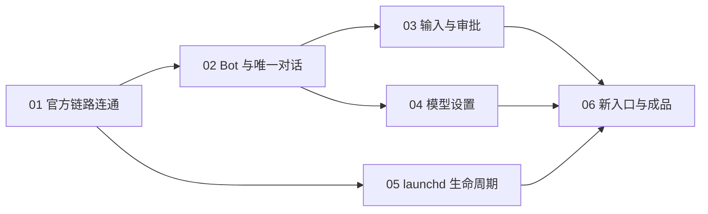

# NSH 单机重建本地任务

状态：01–05 已完成本地实现与验收；06 已切换入口、清理旧链路并构建 macOS 成品。真实 NSH 端到端验收通过，成品 GUI 操作因系统锁屏待补。详见 [验收记录](EVIDENCE.md)。不发布 GitHub，不修改旧 spec #1 或其子任务。

规格：[SPEC.md](SPEC.md)。来源为已经确认的[蓝图](../../docs/BLUEPRINT.md)与[架构](../../docs/ARCHITECTURE.md)。

## 任务与依赖

| 编号 | 任务                                                 | 阻塞于     | 可验证交付                                                                   |
| ---- | ---------------------------------------------------- | ---------- | ---------------------------------------------------------------------------- |
| 01   | [NSH 与官方 dsh web 连通](issues/01-connectivity.md) | 无         | 在真实 NSH 中完成认证、Remote HTTP、认证 WebSocket、事件流、审批、取消及重连 |
| 02   | [Bot 与唯一对话](issues/02-bot-conversation.md)      | 01         | 创建未就绪 Bot、补齐配置、初始化、纯文本流、关闭重开和故障恢复               |
| 03   | [输入与审批生命周期](issues/03-input-approval.md)    | 02         | 排队撤回、未知结果核对、停止保留队列、审批与归档中的既有工作                 |
| 04   | [模型与凭据设置](issues/04-model-settings.md)        | 02         | 共享设置、revision 冲突、密钥提交、默认/当前模型区分与切换                   |
| 05   | [launchd 生命周期](issues/05-launchd.md)             | 01         | 托管官方后台、识别当前 ready 日志、版本检查、显式停止和异常恢复              |
| 06   | [默认入口与成品交付](issues/06-macos-integration.md) | 03、04、05 | 切换新入口、移除旧 Runner/runtime、更新构建并完成 macOS 成品闭环             |

依赖只列直接阻塞边。01 是当前可开始的任务；01 完成后 02 与 05 可并行，02 完成后 03 与 04 可并行。只有完整连通通过后，才允许以新路径逐步替换旧链路；最终清理和成品整合集中在 06。

## 已确认的测试边界

1. **真实 NSH → 官方后台公开协议。** 捕获 Cookie 握手、WebSocket、流和取消的跨运行时问题；不证明 launchd 或真实模型质量。
2. **桌面操作 → 持久恢复的用户可见行为。** 捕获 Bot 初始化、消息、审批和设置的端到端问题；可使用独立 OpenAI 兼容确定性服务，不向产品后台注入测试插件，不替代真实供应商验收。
3. **macOS 成品和生命周期脚本 → 实际进程。** 捕获安装、日志发现、启停和退出恢复问题；正式签名、Intel 与移动端单独报告。

## 执行准备记录（实施前）

- 核对 GitHub tracker、标签与领域文档配置均已存在，不重复 setup。
- 读取现有 spec #1，确认它及现存任务描述旧 Runner/插件/随包运行时路线；保留原记录，准备新 spec。
- 读取当前实际 CLI；本机检测 dsh 为 `0.2.1-rc.5`，NSH 为 `0.2.0 (68531fb)`。dsh 可执行入口指向已安装的 DeepSeek Harness 应用运行时；这里只记录候选环境，不宣称整套受支持。
- 在全新临时 DSH_HOME 启动官方 dsh web，回环随机端口就绪；未认证 Session Remote 为 401，根页面 token 换 Cookie 为 303，API connect 为 302，带 API Cookie 的 Session 列表 Remote 为 200。临时进程与数据已清理，凭据未写入本草案。
- 核对上游和 NSH 公开接口：NSH HTTP 可以携带 Cookie；现有 WebSocket 接口无法直接携带该认证 Cookie，仍需实际验证原生传输适配。官方客户端可注入 fetch/createWebSocket，但 QuickJS 执行兼容性尚未证实。

## 执行记录

用户已确认六个任务及测试边界，并要求在本地开始执行。按依赖推进，验收证据记录到对应任务；不会创建、修改或关闭 GitHub issue。
