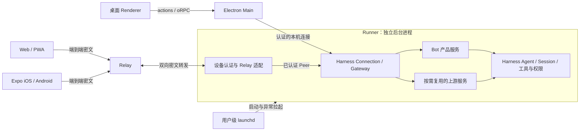

# dsh-bot 架构与工作区方案

本文件汇总已确认的架构决定，给出依赖方向、进程关系和分阶段实施草案。产品行为以 [产品蓝图](./PRODUCT_BLUEPRINT.md) 为准，术语见 [GLOSSARY.md](./GLOSSARY.md)，上游依据见 [Host 与客户端调研](./HOST_AND_CLIENT_RESEARCH.md)。整体依赖图和实施顺序待最终确认，本文不表示对应实现已经完成。

## 当前工程与上游依赖

当前桌面源码位于 apps/dsh-bot，packages/harness-runtime 管理固定版本 Harness npm 依赖与 CLI。目标桌面目录为 apps/desktop，目录、脚本与现有文档尚未迁移；其余目标工作区随实际实现建立。

产品由 Bun 管理 apps/* 与 packages/*，仅维护根 bun.lock。Bun 负责安装和脚本，Node/Electron 承担实际运行。hoisted 安装适配 Electron Forge，Bun 锁文件识别补丁的原因与移除条件见 [patches/README.md](../../patches/README.md)。

引擎从 npm 公开入口消费，版本以 [运行时清单](../../packages/harness-runtime/package.json) 为准。直接使用的 DSH 包锁定同一发行版，Cordis/Loader 使用该发行版要求的相容版本；各包 latest 标签不能作为相容依据。需要共享 Host 实例的服务在插件中使用 peerDependencies，并保留构建外部引用。

上游固定在 references/deepseek-harness Git submodule，仅供阅读、调试与兼容性研究，产品构建不从其 src 或 lib 导入。参考指针更新与 npm 引擎升级分别管理。独立工程将上游跟进集中在依赖升级和兼容验证，产品拥有自己的 UI、Bot 规则与交付流程。

## 目标工作区

| 位置                     | 职责                                                                            | 交付时机             |
| ------------------------ | ------------------------------------------------------------------------------- | -------------------- |
| apps/desktop             | Electron Main、preload、桌面入口、原生能力、Runner 本机管理与打包               | 首版 macOS           |
| apps/runner              | 命名 dsh profile、Host 装配、后台生命周期与运行时发布                           | 首版 macOS           |
| apps/web                 | 独立 React Web/PWA 入口、导航、浏览器连接、安装配置与发布                       | 后续 Web/PWA         |
| apps/mobile              | 一个 Expo 项目交付 iOS、Android，提供原生移动交互                               | 后续原生移动端       |
| apps/relay               | 设备连接路由、在线状态与密文转发                                                | 远程交付             |
| packages/bot             | Bot 产品服务、配置与 Session 关联、Agent 生命周期、必要的 Remote 声明和生成贡献 | 首版                 |
| packages/client          | 跨端可用的调用、状态与连接逻辑，提供平台适配入口                                | 按实际消费者提取     |
| packages/web-ui          | 桌面与 Web 实际相同的聊天、输入、审批、工具结果、附件等业务组件                 | Web 提取阶段         |
| packages/harness-runtime | 固定版本 Harness 依赖和运行时资源定义                                           | 已有，随 Runner 完善 |
| packages/plugin-*        | 按独立加载、依赖隔离或分发需要组织的标准 Harness 能力插件                       | 按具体能力新增       |

apps 放可独立构建或交付的应用，packages 放实际共享的代码或需要独立装配的插件。移动端与 Relay 的目标位置不要求现在创建空工作区。设备配对与 Relay 接入先在 Runner 内部独立组织，出现独立装配、分发或实际复用需求后再拆包。

## 运行进程关系

macOS 用用户级 launchd LaunchAgent 管理 Runner，支持异常自动拉起与可选登录自启；主动停止后保持停止，直到再次启动或满足已启用的登录自启条件。桌面先连接已有 Runner，必要时请求启动；退出桌面不停止 Runner，客户端断线不终止已接纳执行。Bot 执行实例属于同一个 Runner，工具等能力仍可按 Harness 自身机制创建子进程。

首版安装包携带可独立运行的后台及所需运行时，用户无需系统 Node、Bun、pnpm 或 dsh。运行时的具体供给、用户级安装位置、版本切换、签名和有序升级停止需要打包原型验证。Runner 自动重启遵守产品恢复规则，不自动重发输入或重复工具。

## Bot 产品服务的职责

packages/bot 通过 Harness/Cordis 标准插件机制加载，提供 Bot 档案与配置持久化、模板具体化、Bot 与 Session 的关联、AgentHandle 生命周期，以及配置变更与新输入接纳的协调。模型循环、队列、会话日志、权限与工具执行继续使用 Harness。

该包拥有产品服务实现及其必要的 Remote 声明、错误类型和生成贡献。后台实现入口与客户端安全的类型和 Remote 贡献入口分别导出；前端只消费对应的客户端入口。Bot 配置存储与 Session 日志的所有权分别明确，存储选型及一致性实现待详细设计。

首次发送前由 Bot 服务建立唯一 Session 关联。配置更新时，服务协调真正空闲的检查、旧 Agent 释放、预设更新、同一 Session 的恢复、持久化与失败恢复；完整要求与实验依据见 [Harness 配置接入探索](./HARNESS_INTEGRATION.md)。所有可能触发 Agent 激活的入口都必须经过同一生命周期所有者协调。

apps/runner 负责选择 profile、组合进程服务与插件、配置数据目录并发布后台应用。产品规则集中在 Bot 服务中，执行侧状态由 Runner 持有，窗口和页面只通过服务接口读取与操作。

## 代码依赖与客户端复用

| 消费方           | 依赖内容                                                         |
| ---------------- | ---------------------------------------------------------------- |
| desktop Renderer | web-ui、桌面 actions 与平台适配；原生和后台操作继续经过受控 oRPC |
| desktop Main     | client 的 Node 适配、本机 Runner 管理、窗口与系统能力            |
| web              | web-ui、client 的浏览器适配、Web 路由与 PWA 配置                 |
| mobile           | client 的 React Native 适配、Expo 页面与平台能力                 |
| web-ui           | React DOM 业务组件、显式传入的业务数据与操作入口                 |
| client           | 所属服务的客户端安全声明与生成贡献、适用的状态和传输逻辑         |
| runner           | bot、Harness runtime、选定工具插件、设备和连接模块               |
| relay            | 路由与密文传输所需模块                                           |

web-ui 优先共享消息、输入、审批、标准工具结果与附件组件；desktop 和 web 分别拥有路由、导航、布局与平台功能。适合共同维护的完整页面在出现时再提取。共享包通过明确的业务数据和操作入口使用客户端能力，不导入应用目录；客户端状态只反映 Runner 的执行事实。

apps/mobile 使用 Expo 与 React Native 实现 iOS/Android。Web/PWA 保持独立 React Web 应用。各平台共享适用的协议、客户端逻辑和非平台业务代码，界面与系统能力按环境适配。SDK 版本、依赖解析和浏览器/Node/Hermes 下的模块兼容性以原型验证后锁定，依据见 [Expo 调研](./HOST_AND_CLIENT_RESEARCH.md#expo-web-与-pwa-的具体支持)。

## 服务协议与 Relay 传输

产品服务沿用 Harness Host、Gateway 和标准 Remote 机制，声明与生成贡献由所属服务维护。Bot 身份、配置和关联属于产品服务，执行事件与历史语义按需复用上游。各客户端可以提供不同功能集合，操作的参数、结果和错误语义保持一致。

Relay 传输层处理连接、路由和端到端密文，Runner 验证设备身份并映射到受控 Peer，再执行业务授权与调用。配对确认、身份、会话加密与重放保护采用经过审查的现有协议或库，具体选择尚待验证。Relay 的路由元数据与业务密文分别定义，业务状态由 Runner 选择并按订阅发送。

| 内容                                     | 传输方式与所有权                                       |
| ---------------------------------------- | ------------------------------------------------------ |
| 发消息、停止执行、撤回输入、审批及结果   | 加密请求与响应，由 Runner 接纳与裁决                   |
| Bot 状态、实时回复、工具活动、待处理事项 | 按实际订阅转发，客户端重连后恢复                       |
| 历史                                     | 按需分页并根据上游游标补齐                             |
| 图片、文件、会话附件与工具产物           | 通过认证的加密资源通道按需传输，独立处理大小和流量限制 |
| 本机窗口、布局、Runner 安装与启动        | 所属客户端与本机系统处理                               |
| 已存模型密钥                             | 保留在执行侧，不作为客户端同步内容                     |

Relay 首次交付仅支持客户端与 Runner 同时在线，不承担离线请求存储与稍后投递。接纳确认、持久历史与执行完成分别表达；断线且未取得确认时保留结果未知状态。优先核对上游 requestId、inbox 和历史记录可提供的去重与恢复能力，再补足必要协调，不承诺未经验证的持久幂等保证。

历史事件、当前状态和临时回复片段分别处理，重连从 Runner 取得相应基线和增量。普通调用与大内容资源读取分别组织；客户端不会因为订阅状态而自动同步整个工作目录。大文件断点续传、整目录同步与离线请求暂存均在首次远程交付之外。

## 设备配对与授权

首批远程连接限本人设备。桌面展示一次性二维码或配对码，新设备连接后由桌面确认；每个设备获得独立身份，桌面可以查看和撤销。配对设备获得该 Runner 下全部 Bot 的已确认协作能力，管理操作保留本机桌面。具体协作范围见 [产品蓝图](./PRODUCT_BLUEPRINT.md#多端演进)。

授权由 Runner 实施，界面的功能可见性反映授权结果。设备撤销需终止该身份后续访问和已建立连接，正在执行的工具与已接纳请求按已有产品语义处理。远程设备不会统一映射为 owner 来绕过上游授权；审批、资源读取和事件跟随的实际接入能力需逐项验证。

设备记录、配对和撤销策略由 Runner 的设备模块持有，Bot 配置由 bot 包持有；两个模块通过明确的身份与授权接口协作。Relay 运营或路由身份不替代 Runner 的设备信任。

## 插件与能力装配

普通插件提供服务、工具、提示词或事件；bundle 通过 dsh.bundle 提供配置层，profile 通过 dsh.profile 组合 bundle。Harness 后台通过命名 dsh profile 启动，插件发行提供 ESM 和类型。共享框架服务使用相容 peer 依赖，纯工具库使用普通 dependencies。

通用能力插件能在其他 Harness profile 中使用；产品插件负责 dsh-bot 自己的规则。首版随应用装配，使用标准工具结果呈现。无需为每项能力建立一个包：按独立加载、依赖隔离、分发或实际复用需要拆分。

## 分阶段实施草案

| 阶段              | 工作                                                                                            | 完成条件                                                                  |
| ----------------- | ----------------------------------------------------------------------------------------------- | ------------------------------------------------------------------------- |
| 1. 工程归位       | apps/dsh-bot 迁至 apps/desktop，更新根脚本、CI、IDE 和相对路径；统一全局设计文档的归属          | 安装、检查、现有单元、打包 E2E 与成品冒烟通过，保留用户已有改动           |
| 2. 接入原型       | 发布版依赖下装配 Runner profile、Bot 服务与生成 Remote；验证客户端最小组合及 Agent 生命周期协调 | 同一 Bot 唯一 Session，空闲配置即时生效、失败恢复，调用和跟随在替换后可用 |
| 3. 本机产品闭环   | Bot 管理、真实模型与工具、审批、队列操作、后台进程管理和安装资源                                | 桌面退出后执行继续，异常拉起与主动停止符合语义，无外部运行时可用          |
| 4. Web/PWA 与远程 | 建立独立 web，按实际需要提取 client/web-ui；实现设备配对、Relay 和端到端资源传输                | 本人设备可完成协作与附件任务，撤销生效，断连与重连状态准确                |
| 5. 原生移动端     | Expo iOS/Android 接入同一业务能力，适配文件、密钥、加密和通知                                   | 两个原生平台完成同一批移动任务及失败路径验证                              |

各阶段只建立实际需要的模块，后续应用可用原型提前验证兼容风险。通知的首批交付范围、Relay 部署与运营方式、加密协议、具体存储和更新机制在进入对应阶段时细化；这些未定项不改变当前工作区职责。

## 实施前需要验证的接入点

1. Session Controller 自带的冷恢复与 Bot 所有的 AgentHandle 如何统一。公开接口不足时，评估最小上游扩展或明确版本的兼容包，继续避免复制控制器或改动执行循环。
2. 官方客户端的浏览器工厂、Node ESM 与 Expo/Hermes 能否在所需最小组合中使用；跨端模块产物和生成工具需要实测。
3. 非 owner Peer 的授权、审批回答和文件路由能否覆盖配对设备能力。现有 owner 限制不能通过换传输地址解决，优先复用上游服务并按标准插件接口补充必要适配。
4. 消息接纳去重、配置持久化与运行时应用的崩溃恢复，需要区分现成保证和应用必须补足的协调。
5. 独立后台的随包运行时、用户级安装、签名、更新与启动停止，需要在真实 macOS 成品中验证。

现有独立 npm profile 启动及 Agent 替换实验支持上述接入方向，但尚未覆盖这些完整场景。原始证据保留在 [Host 与客户端调研](./HOST_AND_CLIENT_RESEARCH.md) 和 [Harness 配置接入探索](./HARNESS_INTEGRATION.md)。
