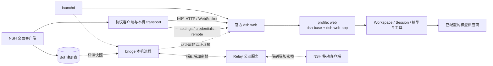

# dsh-bot 架构与实施方案

本文是整体技术方案的唯一真源，说明进程、工作区、配置 UI、协议、数据归属与实施顺序。产品规则见[产品蓝图](BLUEPRINT.md)，概念见[术语表](../GLOSSARY.md)，上游证据与历史探针见 [research](research/)。

状态：单机重建已进入本地实现与验收，客户端、输入审批、模型设置及 launchd 路径已切换；旧 `apps/runner`、`packages/harness-runtime` 与客户端产品 REST 适配已移除。首版采用上游模板重启语义，交付纯文本持续对话；独立指令、Bot 记忆与附件延后。本文区分架构决定、上游源码证据和待验证项；本机验收范围见 README 与本地任务记录，多端及正式签名尚未交付。

## 1. 系统概览



实线为单机阶段，虚线为后续多端阶段。系统边界：

1. 一个官方 `dsh web` 执行进程使用一个上游 `web` profile，承载全部 Bot；产品不注入 Host 服务、Agent Loop 或自有 bundle。
2. 桌面客户端管理 Bot 注册表和交互；后台管理 Session、执行状态、模型设置与凭据。两侧各有明确的数据所有者。
3. 模型供应商在桌面设置页统一配置；Bot 初始化前选择默认模型，初始化后显示并切换当前 Session 模型，不重复保存供应商连接或密钥。
4. 多端增加本机 bridge 和公网 Relay。后台只接受本机连接，Relay 只转发端到端加密帧，不持有后台 owner 凭据。
5. Bot 注册表由桌面独占写入，手机只读快照；执行协议继续复用上游，注册表不引入多端合并协议。

## 2. 仓库与组件

| 位置 | 职责 | 阶段 |
| --- | --- | --- |
| `apps/client` | NSH TSX 界面、协议客户端、Bot 注册表、模型设置页、最小审批与平台适配 | 单机 |
| `scripts` | LaunchAgent、启停与日志、构建、macOS 组装与验收 | 单机 |
| `apps/bridge` | 出站连接、设备授权、转发与只读 Bot 快照 | 多端，尚未创建 |
| `apps/relay` | 设备连接路由、密文转发及有界投递队列 | 多端，尚未创建 |
| `references` | 固定提交的上游参考，供阅读与兼容性研究 | 只读参考 |

目标工作区移除旧 `apps/runner` 与 `packages/harness-runtime`，不新增 `packages/*`。Bun 管理根工作区和唯一 `bun.lock`。运行使用用户安装的官方 `dsh`；需要的客户端协议依赖消费 npm 公开产物，相关 Harness 直接依赖精确锁定同一发行版。参考源码不参与产品安装、源码导入、类型配置或打包。

## 3. 装配与启动

产品数据根为 `~/.dsh-bot`，与用户的 `~/.dsh` 隔离；固定使用上游 `web` profile：

```sh
DSH_HOME=~/.dsh-bot dsh web --no-open
```

LaunchAgent 使用已安装 `dsh` 的绝对路径，并显式设置 `DSH_HOME`。进程由 launchd 启动和监督，客户端退出不停止后台。

首启按上游 `PROFILE_TEMPLATES` 创建 `profiles/web/`，装配顺序为 `@deepseek-ai/dsh-base` → `@deepseek-ai/dsh-web-app`。其配置已包含 webserver、connection、remote、模型适配器、设置控制器、审批协议和内置 Agent 模板，产品无需复制 patch。依据见[官方 bundle 模板](../references/deepseek-harness/packages/util/official-bundles/src/bundles.ts)与 [web-app 装配](../references/deepseek-harness/packages/bundle/web-app/cordis.patch.yml)。

`desktop` 为上游 Electron 应用保留名；自定义 profile 不会自动获得 web 装配。当前方案因此使用 `web` 加隔离数据根，不发布自有 profile 包。未来若确有覆盖需求，须重新评估薄 bundle，不能在本轮重建中顺带引入。

## 4. Bot 与注册表

每个 Bot 是桌面持有的独立对象，保存到 `~/.dsh-bot/bots/<id>.json`：

| 字段 | 含义 |
| --- | --- |
| `id` / `name` | 稳定标识与显示名称 |
| `profile` | 对上游装配的引用，当前恒为 `web` |
| `template` | 创建时选定的 agent preset 标识 |
| `workspace` | 执行工作目录，可指向外部项目 |
| `model` | 初始化前的默认模型选择，引用后台目录中的模型，不保存连接参数 |
| `sessionId` | 唯一 Session 指针，缺失表示尚未初始化；结果未确认的创建另存初始化记录 |
| `archived` | 隐藏默认列表并阻止新输入，不删除历史或工作区 |

`model` 的具体持久化类型须与上游模型目录和选择类型一致。协议可能需要 `{ provider, model, reasoningEffort? }` 来标识模型；其中 provider 是模型标识的一部分，UI 不增加每 Bot 的供应商配置表单，也不复制端点与凭据。

后台不认识 Bot，只认识 Workspace 与 Session。桌面负责注册表校验与保存；移动端没有注册表写入权限。允许先保存未就绪 Bot，再补齐兼容后台、模型、模板与有效工作区；条件不足时保留配置和草稿，提供具体修复入口，满足后才初始化与发送。

首次初始化开始前持久保存候选 Session ID、工作区与模板，并串行处理初始化；结果未确认时保留该记录，先核对后台，不通过编辑配置绕过核对。初始化成功后固定模板与工作区，需要不同组合时新建 Bot；名称与归档状态仍可修改。修改默认模型不覆盖已有 Session，初始化后的主要模型操作是切换当前对话模型。

归档拒绝新输入，但保留已接纳的队列、执行和待审批请求；归档区仍展示未结束工作并允许处理，取消归档后继续原 Session。首版不提供永久删除 Bot、清空历史或清理工作区入口，默认保留数据。

## 5. 模板与能力

模板复用上游 agent preset。`dsh-web-app` 当前内置 `standard`、`ptc`、`minimal`、`cordis`，由 `agent-preset-registry` 提供标识与展示信息；产品不维护另一份模板定义。

新建 Bot 时选择模板，初始化 Session 时传入 `agentPreset`。首版 NSH 只列举、读取和选择已安装的内置或用户模板，提供自建流程说明，不实现模板编辑器。自建模板通过上游声明式 bundle 安装到共享 profile；preset 注册表没有接受模板 YAML 写回的 remote，不能把 settings 动态字段表单当作模板编辑接口。模板决定指令与工具选择，插件代码装配仍属于共享 profile，不提供每 Bot 独立插件运行环境。

首版接受上游重启语义：运行中的 Agent 保留已装配的旧组合；后台重启后，恢复按 Session 保存的 preset ID 加载当前定义。缺失或无效时报错，不自动替换模板，也不持久保存旧代际的插件实现。模板 ID 固定不等于跨重启冻结模板内容。依据见 [preset 注册表说明](../references/deepseek-harness/packages/preset/agent-preset-registry/README.zh.md)。

初始化后模板与工作区固定，首版不提供同一 Bot 的会话替换或重新绑定。Session 恢复失败时区分连接故障、模板问题、历史损坏和确实不存在；保留原 `sessionId`，提供重新检查与故障原因，无法恢复时另建 Bot。

首版指令沿用模板和上游工作区 `AGENTS.md` 机制，刷新遵循上游规则。独立指令编辑、文件重载、内容快照和 Bot 记忆均延后，保留蓝图目标；客户端拼接首条输入不能满足每次模型请求注入记忆的要求，也不因此引入产品插件。

工具随模板启用，NSH 必须提供包含操作信息的允许/拒绝审批。上游 Web 页的审批组件不能直接充当 NSH 的界面。

## 6. 持续对话与模型选择

每个 Bot 一个持续对话入口，对应一个 Session。首次初始化读取 Bot 的工作区与模板，调用上游创建接口，成功后保存 `sessionId`；已有指针时恢复原 Session。创建超时但结果未确认时，先核对后台事实，不自动重发创建请求。

初始化使用 Bot 的默认模型；没有显式选择时沿用后台默认模型。模型来自后台目录，经 `selectModel` 等公开接口提交，不能写死 `deepseek-official`。上游选择接口会在后台异步尝试保存默认模型，选择成功不保证该默认值已持久化；这不等于批量修改其他 Bot 的注册表或已存在 Session。依据见 [Session 命令实现](../references/deepseek-harness/packages/api/session-controller/src/commands.ts)。

恢复对话读取后台记录的模型选择与执行状态，不能以客户端默认值覆盖。初始化前信息区选择默认模型，初始化后显示并切换当前 Session 模型，两者不做隐式双向同步。`selectModel` 记录的选择从下一个执行步骤生效，已经准备的步骤保留捕获的选择，同轮工具后的下一步骤也可能使用新模型。供应商、凭据或模型不可用时报错并保留选择，由用户修复或手动切换；目录暂不可读与后台明确拒绝分开呈现，不能静默回退。

### 输入、队列与停止

首版输入仅含文本。普通发送使用上游排队模式（`next-turn`），显示已接纳的待处理列表，允许撤回尚未领取的消息，不提供 `next-step` 立即插入操作。领取与撤回可能竞争，结果以后台队列和事件为准。

发送前将 `(sessionId, requestId)` 与正文保存到桌面本地。结果未确认时保留“发送结果待确认”，只提供重新核对与复制内容，不自动重发或提供一键重试。修改正文再发送是新输入，须提示旧输入仍可能已接纳。核对范围见第 13 节；不能把查重视为严格一次执行保证。

`session.cancel` 调用 `agent.cancel({ kind: 'user' }, { keepInbox: true })`：取消当前活动并保留尚未领取的消息，返回接纳取消请求不代表已停稳。通常队列等待下一次新输入唤醒；再次发送前提示原队列将按顺序继续。停止期间新的唤醒输入可能使驱动器在取消收敛后继续执行，因此不承诺持续暂停。停止、逐条撤回和停止后台分别提供，客户端不自建队列或通过批量撤回来模拟停止。依据见 [Session 命令实现](../references/deepseek-harness/packages/api/session-controller/src/commands.ts)与 [Agent 驱动器](../references/deepseek-harness/packages/core/agent-loop/src/agent.ts)。

普通草稿和未确认输入属于客户端本地数据，确认后清理相应临时记录；后台接纳状态仍由 Session 事实决定。首版通过对话跟进工作目标，不建立独立目标对象、完成按钮或状态存储。

## 7. 通信与配置 UI

### 连接与传输

客户端在 NSH 中适配上游 HTTP / WebSocket 协议，处理 token 引导、Cookie、流与取消。认证入口和返回状态必须按实际调用路径验证；浏览器 URL 引导与 API `/connect` 路径不能混用假定。Cookie 按服务返回值管理，不硬编码名称。

发现使用后台 stdout 的 `dsh web:` ready 行，不占固定端口、不另写发现文件。launchd 持有进程，客户端通过受控日志读取当前启动的 ready 信息并验证连接；旧日志中的失效 token 不能作为有效连接事实。日志权限、轮转与重启关联在单机阶段验收。

协议客户端从第一天区分本机与未来 Relay transport，承载上游请求、流、取消和连接关闭。断线后重新读取状态；未确认的写请求不得自动重放。Bot 快照是 bridge 的单独产品数据契约，不替代上游 Session 协议。

### 模型与凭据设置页

桌面提供独立设置页，集中管理共享供应商、端点、模型目录与凭据；Bot 信息区在初始化前选择默认模型，初始化后显示并切换当前 Session 模型。设置页通过现有 remote 工作，不直接改写 settings 文件、patch 或 LaunchAgent 环境变量，也不新建 `providers.json`。

| 操作 | 上游入口 | 客户端规则 |
| --- | --- | --- |
| 读取配置 | `settings.describe()` | 使用脱敏 `schema`、`value`、`revision`、`applies` 与可写状态渲染 |
| 修改配置 | `settings.update(ns, patch, expectedRevision)` 或 `settings.mutate(ns, ops, expectedRevision)` | 携带读取时的 revision，只写用户修改的字段 |
| 读取凭据状态 | `credentials.describe(refs)` | 只显示脱敏元数据，不请求密钥回显 |
| 保存或移除密钥 | `credentials.set(ref, value)` / `credentials.unset(ref)` | 机密仅在提交时发送，提交后清除输入，不进入持久缓存或日志 |
| 选择默认模型 | 上游模型目录与模型选择接口 | 保存稳定选择，不复制供应商配置 |

设置页是目录驱动的模型配置界面：先以 `llm.listConfigurableProviders()` 获取包括未启用项在内的可配置供应方，再按返回的 `settingsNs/settingsPath` 关联设置表单。Bot 模型选择器另用 `session.modelCatalog()` 获取当前可路由模型；两份目录用途不同。模型选择请求为 `{ sessionId, provider, model, reasoningEffort? }`。

`settings.describe()` 的 schema 是 Schemastery `toJSON()` 信封，只投影 `.volatile()` 字段，并非完整配置的标准 JSON Schema；namespace 是 profile entry ID，不能假定等于包名。客户端按此契约实现字段组件与供应商专用操作，不能把 `autoGenerate:false` 的提供方当作无需适配的通用表单。无法支持的字段明确提示，不能凭猜测覆盖。脱敏占位值不能作为真实密钥提交，也不以整段 replace 覆盖未编辑配置。

`settings/conflict` 表示已读 revision 过期：保留草稿、重新读取，再由用户确认。`settings/rejected` 与 `credential/rejected` 展示后台校验或存储错误。密钥提交与设置提交是两个调用，不声称具备跨调用事务；界面分别报告结果，失败后不自动清除仍被引用的凭据。

`llm-pi-ai` 支持目录供应商、OpenAI 兼容网关与自托管路由，其配置与凭据按请求解析，变更可在下次请求生效，已开始的请求保留原快照。自定义路由须提供 `api/baseURL` 与非空模型清单；`models` 替换目录，`modelOverrides` 修改内置目录，两者互斥。保存后刷新配置状态与模型目录，保存成功不等于推理端点可用。

当前 settings 表单只提供动态字段，`applies` 为 `live`；普通插件配置不在该表单范围内，不能统一宣称下一请求生效或必须重启。环境变量用于引导与自动化，也是上游持续存在的凭据兜底来源；移除已保存密钥后可能重新显露环境值，界面须刷新来源状态。

macOS launchd 不继承终端的临时导出变量。启动包装脚本经非交互登录 zsh 读取用户登录配置，再以同一 PID 执行官方 CLI，直接由后台继承凭据，不把环境密钥复制到 plist、客户端或凭据文件。shell 初始化输出不进入后台日志，登录配置加载后重新固定产品数据根。登录配置中的环境变量更改需重启后台；设置页保存的凭据仍遵循上游即时解析规则。

接口依据见 [Settings Controller](../references/deepseek-harness/packages/api/settings-controller/src/index.ts)、[错误类型](../references/deepseek-harness/packages/api/settings-controller/src/types.ts)与 [llm-pi-ai 说明](../references/deepseek-harness/packages/llm/llm-pi-ai/README.zh.md)。运行发行版仍须实测这些契约。

### 最小审批

普通消息区展示用户消息与 Agent 文本，不展示工具结果卡片或推理过程。审批界面展示后台请求中的工具名称、操作摘要与关键目标（命令、路径或域名），详细参数按需展开，并提供允许/拒绝。拒绝不扩大授权，断线不静默放行。

单机首版接受无在线 UI 时等待重连，不增加常驻自动审批端；恢复后显示“等待审批”，拒绝、取消或失效后更新状态。不假定断线立即拒绝或存在统一审批超时。请求归属、并发、取消与审批连接的存活条件仍须通过实际报文验证。

## 8. 持久化与所有权

| 数据 | 所有者 | 保存边界 |
| --- | --- | --- |
| Bot 注册表 | 桌面客户端 | `~/.dsh-bot/bots/`，移动端只读快照 |
| Session、执行历史与当前模型 | 上游服务 | 默认会话日志根为 `$DSH_HOME/sessions/`，本产品为 `~/.dsh-bot/sessions/` |
| 模型供应商与模型目录设置 | 上游 settings 提供方 | 上游 profile 配置存储 |
| 模型密钥与凭据引用 | 上游 credentials 提供方 | 默认 `credentials-local` 写入 `~/.dsh-bot/.credentials.yaml`，权限 `0600`；不是系统 Keychain |
| 模板与插件装配 | 上游装配与安装流程 | 共享 profile 目录；NSH 首版只读取已安装模板 |
| 草稿、未确认输入与初始化记录 | 桌面客户端 | 本地保存正文、请求标识及核对所需字段，确认后清理相应临时记录；不保存密钥 |
| 界面偏好 | 客户端 | 主题、窗口、本地选择等非执行状态 |
| 连接 token / Cookie | 连接适配层 | 运行期使用；ready 日志须限制访问，不进入 Bot 文件 |
| 后台日志 | launchd 与脚本 | `~/Library/Logs/dsh-bot/` |

会话日志根由 base 的 `session-persistence-jsonl.root = dshHomePath('sessions')` 决定，不在 profile 目录内。产品通过独立 `DSH_HOME` 与用户默认的 `~/.dsh` 隔离会话及相关存储；仅更换 profile 名不能保证会话隔离。连接到同一产品后台的官方 Web UI 仍可通过上游会话列表看到这些会话；NSH 按 Bot 注册表的 `sessionId` 展示唯一对话，不提供通用会话列表。依据见 [base 持久化配置](../references/deepseek-harness/packages/bundle/base/cordis.patch.yml)与[会话列表实现](../references/deepseek-harness/packages/api/session-controller/src/list.ts)。

客户端不落盘模型密钥、不维护第二份后台配置。模型密钥、后台连接凭据与设备配对密钥是三类不同数据，不混用。独立指令与 Bot 记忆不进入首版存储设计；后续实现须完整满足蓝图中的快照、版本冲突与逐请求注入要求。

## 9. 多端与 Relay

| 组件 | 职责 | 边界 |
| --- | --- | --- |
| bridge | launchd 托管，主动出站连接 Relay；设备授权；用本机凭据转发上游协议；提供只读 Bot 快照 | 不执行 Agent，不保存权威会话，不写 Bot 注册表 |
| Relay | 设备路由、密文转发、有界投递队列 | 不持后台 owner 凭据，不读取业务正文，不决定执行是否接纳 |
| 移动客户端 | 展示 Bot 快照、提交输入与展示对话，替换 transport | 不安装 dsh，不运行执行引擎，不修改 Bot 或共享模型设置 |

数据流为手机 → Relay → bridge → 本机 `dsh web`。端到端加密终止在移动端与 bridge，bridge 再以本机认证调用后台。桌面本机连接同样需要自己的认证；“Relay 不持凭据”不等于 bridge 是全系统唯一持凭据者。

Bot 注册表采用方案 A：桌面独占写入，bridge 只读注册表并向手机提供快照；手机可看到同样的 Bot 列表，但不能创建、改名、归档、换模板或修改默认配置。桌面窗口退出后 bridge 仍须能读取已保存快照，不依赖活跃 UI。快照刷新与版本用于识别新旧数据，不引入多写者合并。

上游当前网络 owner 认证不能直接等同于每设备的细粒度授权。bridge 必须检查设备身份与允许的调用范围，默认拒绝注册表、settings、credentials、插件装配等管理写入；仅放行已核验的读取和会话交互。方法白名单不足以证明资源隔离，参数、会话归属、事件订阅与审批答复也要校验。

端到端加密旨在保护正文与认证完整性；Relay 仍能观察连接元数据，也可能丢弃、延迟或重放帧。配对、撤销、防重放、队列过期和接纳确认须在多端实施前完成协议设计。Relay 排队成功不等于后台已接纳，断线不自动重发未确认的执行请求。

## 10. 打包与交付

单机交付为 NSH 客户端、LaunchAgent 与脚本，使用用户已安装的 `dsh`，数据根为 `~/.dsh-bot`。不携带 Node，不自建运行时解析。LaunchAgent 配置绝对可执行路径、`DSH_HOME`、启动监督和日志；不把模型密钥写入 plist。

客户端启动后确认后台就绪并检查实际运行版本，再认证并拉取状态。首版只支持一个经过实测的 dsh 发行版，具体版本在连通验收时记录；不兼容时保留本地草稿、说明支持版本与修复路径并阻止发送，不自动升级或降级用户的 dsh。安装命令的版本不能替代实际进程版本。

客户端关闭不停止已接纳的工作，遇审批可能等待重连；显式停止后台使用 `launchctl bootout` 或对应启停脚本。`RunAtLoad` 在注册或加载 LaunchAgent 时的行为与是否登录自动加载分别验收，本轮不增加开机自启产品功能。

多端交付另增 bridge 安装与 Relay 部署，不与第一阶段单机重建混为一次发布。正式签名、公证与其他平台须单独报告。

## 11. 复用与移除边界

继续复用官方 profile 装配、连接认证、remote、Session 队列/取消/持久化、模型与凭据服务、agent preset 和审批协议。客户端自行实现 NSH 界面、transport 适配与 Bot 注册表，多端自行实现 bridge 和 Relay。

旧 `apps/runner` 的产品插件、Host 服务、自建 REST、存储与监督器，以及 `packages/harness-runtime` 的自拼 bundle 已移除；旧专用测试一并删除。客户端 SDK 从公开 npm 产物生成，后台继续使用用户安装的官方 CLI。

其他已放弃方案包括：每 Bot 一个进程或 profile、自建 `dsh-bot` profile 名、`connection.json` 发现文件、自建模型配置副本、用 LaunchAgent 环境变量充当产品密钥配置，以及不提供工具审批的 NSH 客户端。

## 12. 分阶段实施与验收

首版范围与恢复规则已经确认；先执行 NSH 连通实测，再替换旧链路。第 13 节保留验证任务，不再将已确认的产品取舍列为待定。独立指令、Bot 记忆与附件进入后续阶段。

| 阶段 | 工作 | 完成条件 |
| --- | --- | --- |
| 1. 上游与 NSH 连通 | 指定实际 dsh 发行版与 npm 客户端产物，验证 ready 行、认证、HTTP / WebSocket、remote 流、审批与取消 | 记录真实报文及支持版本，验证不兼容时阻止发送并保留草稿；明确客户端复用范围，解决传输限制后再删旧链路 |
| 2. 单机重建 | 移除旧 runner/runtime；实现 Bot 注册表、唯一对话、已安装模板选择、纯文本队列与审批 | 未就绪修复、初始化核对与指针保存恢复、模板重启语义、故障分类、归档保留、排队撤回、停止后保留队列及离线审批通过；未确认请求不自动重发 |
| 3. 模型配置 UI | settings 表单、revision 保存、凭据写入、目录与默认/当前模型选择 | 冲突不覆盖、密钥不回显/不落盘、写入错误可见、模型按步骤生效、恢复不覆盖选择、不可用不静默回退 |
| 4. macOS 成品 | LaunchAgent、日志与重启发现、安装路径、显式停止、成品依赖 | 实际进程和成品验证日志轮转、旧 ready 行、安装路径变化与异常退出；启动失败可见且有效节流 |
| 5. 后续独立能力 | 分别设计独立指令、Bot 记忆与附件 | 指令排他来源/显式重载/快照、记忆版本冲突/每次请求注入上限单独验收；附件覆盖上传、模型能力、持久化告知与未确认附件恢复，不能只实现文件选择界面 |
| 6. 多端设计与实现 | 明确加密/配对/确认协议，再实施 bridge、Relay 与移动端 | 只读快照、资源权限、撤销、断线恢复、未确认请求不重发、审批竞争与移动端生命周期分别验证 |

后续独立能力与多端阶段不属于首版，彼此不预设依赖顺序。

所有阶段保留用户未提交内容和参考子模块，不改写 Git 历史。按根与工作区实际 `package.json` 更新检查入口，并报告本机、真实模型、移动端与签名交付的验证范围。确定性模型测试不能代替真实模型与移动设备验收。

## 13. 未验证与后续边界

### 已确认的重建边界

首版接受模板按 ID 在重启后重新装配，初始化后固定模板与工作区；Session 恢复失败保留指针，模型不可用保留选择，均不静默替换。审批展示操作信息并允许离线等待，普通发送排队，停止保留未领取输入。独立指令、Bot 记忆、附件、独立目标管理、模板编辑器与永久删除不属于首版。规则分别见前文与蓝图；以下保留需要实际证明的技术契约。

### 单机阶段必须通过的实测

1. **NSH 与实际发行版连通。** 使用 npm 公开产物验证 token 引导、Cookie、WebSocket、remote 事件流、审批、取消与重连，确定上游连接包在 NSH 中的可复用范围。通过前保留可运行旧链路。
2. **Session 初始化与注册表保存恢复。** 分别覆盖后台已创建但客户端未收到结果、客户端已收到结果但 `sessionId` 保存失败。上游接受客户端指定 Session ID，但只复用符合条件的空白 Session，返回 ID 也可能不同，不能把重复 `create` 当成通用恢复接口。发送创建前保存候选 ID、工作区与模板并串行初始化，结果不明先查询事实；正式指针保存成功后才允许输入。该流程须证明可以找回已创建的 Session，并处理工作区挂接失败等部分成功状态；创建结果不明与已有 Session 丢失不得混为一类自动重建。依据见 [创建契约](../references/deepseek-harness/packages/api/session-controller/src/types.ts)与[创建实现](../references/deepseek-harness/packages/api/session-controller/src/agent.ts)。
3. **未确认输入的核对。** 上游由客户端提供 `requestId`，后台将其持久关联到消息来源；当前查重覆盖队列与部分历史，不构成并发重试下严格一次执行的保证。发送前保存 `(sessionId, requestId)` 与正文，重连后结合 inbox、入队/撤回事件和必要的历史分页核对，不能只看最近消息或因未查到就判为未接纳；未确认请求不自动重发。验证本地记录恢复、重新核对、复制内容与确认后清理。严格并发去重若成为要求，需上游补齐契约。依据见 [输入命令与查重](../references/deepseek-harness/packages/api/session-controller/src/commands.ts)。
4. **审批连接与离线恢复。** 验证断线后 pending 审批补投、同一 Peer 的活动事件流答复校验，以及多个合格 owner 连接首个有效答复结算的行为；审批不能假定只属于提交输入的客户端，也不能假定无在线 UI 就立即拒绝。多端阶段再明确设备路由、撤销与竞争答复。依据见 [Gateway 实现](../references/deepseek-harness/packages/api/gateway/src/index.ts)与[审批服务](../references/deepseek-harness/packages/interaction/user-approval/src/index.ts)。
5. **launchd 进程发现与失败处理。** 覆盖重启、日志轮转、旧 ready 行、dsh 安装路径变化及异常退出，证明客户端能关联当前进程并验证认证；启动失败须可见，重启节流须有效，不能持续重启刷日志。
6. **模型配置与默认值。** 验证 Session 创建的 Workspace / `agentPreset` 入参、当前模型从下一步骤生效、切换异步保存后台默认值的副作用，以及 settings 字段支持、revision 冲突、凭据存储和分步保存失败恢复。覆盖目录读取失败和模型确实不可用，确保保留原选择、不静默回退。
7. **排队、停止与归档。** 验证正常排队、领取和撤回竞争、取消接纳与停稳的差异、停止后保留队列、再次发送唤醒及取消期间新输入的竞争。归档后禁止新输入，但已接纳工作、排队与审批仍可观察和处理。
8. **模板与故障恢复。** 验证运行期保留组合、重启按 ID 加载当前定义、模板缺失/无效、会话不存在和历史损坏；故障不清指针、不静默替换。覆盖初始化后模板与目录固定、未就绪修复、版本不兼容时保留草稿并阻止发送。

### 后续阶段保留事项

- bridge/Relay 的配对、密钥生命周期、防重放、离线投递、设备撤销、资源授权与审批归属留到多端阶段做报文级设计；单机阶段保留 transport 边界，不因此扩大为多端交付。
- 移动端 NSH 界面复用与系统后台限制待实机验证。
- 真实模型、Intel macOS、正式签名与公证须分别验收，当前不能宣称通过。
