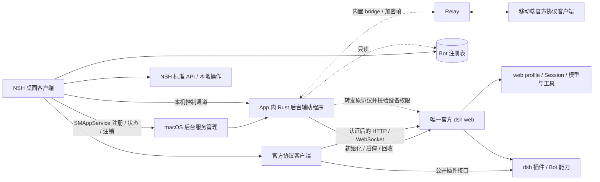

# dsh-bot 架构与实施方案

本文是整体技术方案的唯一真源，说明进程、工作区、配置 UI、协议、数据归属与实施顺序。产品规则见[产品蓝图](BLUEPRINT.md)，概念见[术语表](../GLOSSARY.md)，上游证据与历史探针见 [research](research/)。

状态：单机代码已统一为「NSH 标准 API + App 内轻量 Rust 后台辅助程序 + 官方客户端协议」。`apps/host` 独占 dsh 生命周期与连接发现，NSH 直连官方 `dsh web` 并负责本地操作与产品交互；默认 App 打包携带 Host，通过 NSH 主进程内的 `SMAppService` 适配登记用户级后台服务。开发模式显式连接同一 Host 的 Unix socket。客户端旧 LaunchAgent 管理链、shell 启动资产和 `scripts/backend` 已删除，不再按组件缺失回退到旧后台。

代码收敛不等于成品验收通过：辅助程序、私有控制通道与 NSH 连接换代已通过隔离进程及真实 NSH 测试；隔离 App 的注册、状态查询与等待注销已通过，但此前 ad-hoc 签名辅助程序被 macOS 以 `OS_REASON_CODESIGNING | Launch Constraint Violation` 拒绝启动，本机没有有效代码签名身份。应用关联服务实际启动、系统名称与图标、批准、重新登录和升级迁移仍须签名成品验证，当前不能宣称发布就绪。旧 `apps/runner`、`packages/harness-runtime` 与产品 REST 保持移除。首版交付纯文本持续对话，独立指令、Bot 记忆与附件延后；多端及正式签名尚未交付。

## 1. 系统概览



实线为当前单机组件与调用关系，虚线为后续多端阶段；系统服务的交付验收边界见第 10、12 节。系统边界：

1. 官方 `dsh web` 使用上游 `web` profile，承载全部 Bot；产品通过声明式 bundle 使用官方或产品能力插件，保持官方 CLI、Agent Loop、输入队列与会话存储的实现不变。
2. Rust 宿主是 App 内的轻量后台辅助程序，负责子进程所有权、启动发现、版本检查、日志与退出清理，后续承载 Bridge。NSH 标准 API 负责本地文件、普通命令与网络操作，NSH 中的官方客户端负责认证、remote、订阅、状态恢复与审批；Bot 能力由 dsh 插件实现。
3. 桌面持有 Bot 注册表与交互状态；dsh 持有 Session、执行状态、共享设置与模型凭据。Rust 不保存第二份执行状态，也不转换消息或工具事件。
4. 单机执行和插件交互由 NSH 通过官方客户端直接到 dsh。`HostControl` 的本机控制 Interface 只用于宿主管理与连接发现，不增加 `ProductService` 或统一业务网关。
5. 多端 bridge 以后加入同一个 Rust 宿主，转发官方协议并提供只读 Bot 快照；Relay 只转发端到端加密帧。移动端继续使用官方客户端，不另建统一聊天接口。
6. 关闭 UI 不停止 Rust 或 dsh；显式停止宿主才清理 dsh。此处保留本产品常驻语义，区别于跟随 UI 退出的子进程生命周期。

## 2. 仓库与组件

| 位置          | 职责                                                                     | 阶段               |
| ------------- | ------------------------------------------------------------------------ | ------------------ |
| `apps/client` | NSH TSX 界面、官方协议客户端、Bot 注册表、模型设置页、审批与原生网络适配 | 已实现 |
| `apps/host`   | 随 App 打包的 Rust 后台辅助程序：dsh 进程、控制与发现；后续内置 Bridge | 已实现，系统服务待签名验收 |
| `scripts`     | 构建、macOS 组装与验收；不管理另一套 dsh 进程 | 已统一 Host 入口 |
| `apps/relay`  | 设备连接路由、密文转发及有界投递队列                                     | 多端，尚未创建     |
| `packages/dsh-plugin-*` | 按需实现 Bot 能力及其专属数据、公开接口；通过声明式 bundle 装配 | 后续按能力新增 |
| `references`  | 固定提交的上游参考，供阅读与兼容性研究                                   | 只读参考           |

旧 `apps/runner` 与 `packages/harness-runtime` 保持移除。允许按需求新增 `packages/dsh-plugin-*` 能力插件及其声明式 bundle，不预建空包。Bun 管理 JS 工作区和唯一 `bun.lock`；`apps/host` 由 Cargo 构建并锁定 Rust 依赖，不在 Rust 中重新实现 Harness。运行使用用户安装的官方 `dsh`；客户端与能力插件依赖消费 npm 公开产物，Harness 直接依赖精确锁定同一发行版，共享 Host 服务以兼容 peer 契约复用。参考源码不参与产品安装、源码导入、类型配置或打包。

## 3. 装配与启动

产品数据根为 `~/.dsh-bot`，与用户的 `~/.dsh` 隔离；固定使用上游 `web` profile：

```sh
DSH_HOME=~/.dsh-bot /absolute/path/to/dsh web --host 127.0.0.1 --port 0 --no-open
```

### 宿主与初始化

宿主是随 `.app` 打包、具有本 App 身份与签名归属的后台辅助程序，通过 `SMAppService` 注册，由 macOS 服务机制维持生命周期。NSH 负责注册、注销与状态呈现；系统要求用户批准时展示状态和操作指引。服务入口直接执行辅助程序，不使用 `sh` 或 `zsh` 充当后台服务主体。普通子进程调用本身不需要独立 Host；保留辅助程序是为了 App 后台身份、UI 退出后持续运行，以及后续多端通信。系统显示效果以第 10、12 节的成品验收为准。

宿主独占该产品数据根的宿主实例锁，再持有唯一 dsh 子进程。另设 dsh 生命周期锁：启动前排他取得，经握手交给 guardian 持有，直到其确认旧 dsh 进程组已回收才释放。宿主死亡只释放宿主实例锁，新宿主即使已启动，也必须等待生命周期锁，不能仅凭旧 PID 消失就 spawn。清理超时进入故障，不强行越过屏障。多个窗口、多个 Bot 复用同一个 Host，不按 Bot 建进程池。客户端附着不增加决定进程寿命的引用计数，最后一个窗口关闭也不回收 dsh。

宿主内部分为三个 Module，各自只暴露职责所需的 Interface：

| Module | 职责 | 权威来源 |
| --- | --- | --- |
| `DshProcess`（`apps/host/src/dsh_process/`，公开入口为 `Lifecycle`） | CLI 解析、登录环境、初始化、spawn、ready、版本、日志、子进程回收及并发启动归并 | 当前受管子进程与生命周期记录 |
| `HostControl`（`apps/host/src/host_control/`） | 本机宿主状态、连接发现、启动/停止/重启入口及共享控制协议 | `DshProcess` |
| `Bridge` | 后续设备配对、远端授权、官方协议转发及获授权的产品交互访问 | 设备授权、上游协议与产品权限规则 |

先实现 `DshProcess` 与 `HostControl`，多端阶段再加入 `Bridge`。宿主源码按职责组织：

```text
apps/host/src/
├── main.rs                 # 启动模式、参数、信号与装配
├── lib.rs                  # Module 声明及共享控制 Interface 的兼容导出
├── config.rs               # 路径与启动配置校验
├── runtime.rs              # 私有运行文件与标识生成
├── host_control/
│   ├── mod.rs              # 控制 Interface
│   ├── server.rs           # socket、同用户校验、请求分派、状态订阅
│   └── protocol.rs         # 共享协议类型、帧、响应校验与本机调用
└── dsh_process/
    ├── mod.rs              # Lifecycle：串行操作与并发启动归并
    ├── lifecycle.rs        # 启停、ready、generation 与自动恢复策略
    ├── state.rs            # 持久化用户启停意图与失败预算
    ├── guardian.rs         # guardian 执行模式、生命周期锁与进程组回收
    ├── environment.rs      # 登录环境与 CLI 路径、版本检查
    └── logs.rs             # 脱敏后的诊断日志轮转
```

`HostControl` 只通过 `Lifecycle` 访问当前状态和生命周期操作，不访问其内部进程锁或 guardian；监控线程同样调用 `Lifecycle::tick`。`dsh_process/` 的子模块均为私有实现，只有 `Lifecycle` 和供可执行入口分派的 `run_guardian` 对外导出，guardian 不属于控制通道操作。`main.rs` 不实现控制协议或生命周期策略，`lib.rs` 保留 NSH 原生适配已使用的共享控制 Interface 导出。

`Lifecycle` 在内部串行处理启动、停止、重启与自动恢复；请求处理器不持有进程锁，也不解释启动去重规则。并发 `ensure` 通过独立的启动尝试编号共享一次结果，范围覆盖准备、等待 ready 与失败清理，避免后到请求在清理结束后再次清空预算并启动。状态快照在慢启动期间仍可读取。

不设 `ProductService`：本地配置与产品交互由 NSH 直接完成，已有 dsh remote 由官方客户端调用，不为每个方法增加 Rust 包装。Rust 原生适配与常驻进程是两回事：仅为补足 NSH 标准 API 的缺口，可使用 NSH 进程内原生模块，无须另起后台。

参考 Gallery 的 [Standard APIs](../references/nsh/examples/gallery/demos/StandardActions.tsx)、[WebSocket 示例](../references/nsh/examples/gallery/demos/StandardWebSockets.tsx)及 [AI Chat CLI 调用](../references/nsh/examples/gallery/demos/chat/local.ts)：NSH 支持文件、子进程、HTTP / HTTPS、TCP 和两种 WebSocket 接口，权限由 [nsh.json](../references/nsh/examples/gallery/nsh.json) 声明。AI Chat 每轮启动 CLI、将历史拼成输入，停止或离开页面时杀掉子进程；这是页面生命周期示例，不用于本产品的常驻 dsh。Web 与移动端的该聊天示例是模拟流，不能视为真实多端执行验收。网络授权与握手认证的边界见第 7 节；当前保留原生适配的原因是标准接口不能设置 dsh 所需的认证 Cookie。

初始化职责按对象划分：NSH 使用标准 API 管理 Bot 注册表、草稿与用户选择的工作区；dsh 运行目录及权限、CLI 路径与版本、登录环境、固定数据根和官方 profile 首启装配由宿主独占，客户端只请求启动并展示宿主返回的失败原因，不在调用前重做一套运行准备。不复制上游模板 patch、不另建供应商配置；产品插件经官方安装与声明式 bundle 流程另行装配。已有目录不会覆盖或重置。缺少 CLI、版本不符、目录不可写或 profile 装配失败均返回明确原因与修复入口，保留用户内容。

环境沿用已验证的非交互登录 zsh 方案：读取已导出的登录环境后执行固定的 CLI 与参数，重新固定 `DSH_HOME`；不把密钥复制进 plist、发现记录、日志或客户端。shell 初始化输出与 dsh ready 输出隔离。启动、停止与重启串行化；并发 `ensure` 共享一次启动，客户端超时或关闭窗口不会取消宿主已开始的启动。

### 启动、退出与失败

状态为 `stopped → preparing → starting → ready`，失败进入 `failed`，显式停止进入 `stopping → stopped`。每次新子进程分配新的 `generation`；状态包含失败原因，不把端口可连接等同于 ready。启动期限先采用 Waku 的 20 秒作为验收起点，是否足够覆盖首次装配须实测。

宿主持续排空 stdout/stderr，读取当前子进程的 `dsh web:` ready 行，关联 PID、generation、绝对路径及启动时版本；输出截断、进程提前退出、ready 超时或版本不匹配均不得发布可用连接。ready 行提供连接候选，官方客户端完成认证和协议握手后才允许业务调用。新客户端通过宿主获取当前候选，不扫描历史日志。

dsh 意外退出时先撤销连接候选并通知客户端，再在同一宿主内有界重启：初始采用 1、2、4 秒退避，5 分钟内最多 3 次自动重启，超过后保留 `failed`，等待用户明确启动。计数不因刚出现 ready 就清零；宿主重启后仍保留短期失败计数，避免绕过节流。每次重启先确认旧进程组已退出，禁止同一数据根同时启动两个 dsh。进程重启不重发业务请求。

显式停止宿主会先持久记录用户停机意图、撤销 ready、拒绝新生命周期启动，再关闭未来 bridge 连接并终止 dsh 进程组，等待 5 秒后仍未退出则强制回收；超时强杀可能中断工具，不能称为业务已停稳。普通停止与重启 dsh 同样遵循回收顺序。用户停机意图与重启预算耗尽状态跨宿主重启保留，自动附着不能解除；只有用户明确启动或重启才解除停机阻止，并开始新一轮失败预算。

借鉴 Waku 的 stdin 管道 guardian：宿主持有管道，宿主崩溃或被强制结束导致管道关闭后，guardian 清理 dsh。launchd 仅监督宿主，宿主仅监督 dsh，不形成两层同时重启同一进程的竞争；launchd 端也须配置节流。关闭 UI 不触发上述清理。依据见 [Waku 进程管理](../references/waku/crates/waku-core/src/deepseek_session.rs)与[共享 Host](../references/waku/crates/waku-core/src/deepseek_pool.rs)。

首启按上游 `PROFILE_TEMPLATES` 创建 `profiles/web/`，装配顺序为 `@deepseek-ai/dsh-base` → `@deepseek-ai/dsh-web-app`。其配置已包含 webserver、connection、remote、模型适配器、设置控制器、审批协议和内置 Agent 模板，产品无需复制 patch。依据见[官方 bundle 模板](../references/deepseek-harness/packages/util/official-bundles/src/bundles.ts)与 [web-app 装配](../references/deepseek-harness/packages/bundle/web-app/cordis.patch.yml)。

`desktop` 为上游 Electron 应用保留名；自定义 profile 不会自动获得 web 装配。当前方案使用上游 `web` 加隔离数据根，不发布自有 profile 包。后续产品能力按需通过声明式 bundle 装配 dsh 插件，沿用官方安装与管理流程；增加能力 bundle 不意味着重建 profile 或执行运行时。

## 4. Bot 与注册表

每个 Bot 是桌面持有的独立对象，保存到 `~/.dsh-bot/bots/<id>.json`：

| 字段          | 含义                                                                  |
| ------------- | --------------------------------------------------------------------- |
| `id` / `name` | 稳定标识与显示名称                                                    |
| `profile`     | 对上游装配的引用，当前恒为 `web`                                      |
| `template`    | 创建时选定的 agent preset 标识                                        |
| `workspace`   | 执行工作目录，可指向外部项目                                          |
| `model`       | 初始化前的默认模型选择，引用后台目录中的模型，不保存连接参数          |
| `sessionId`   | 唯一 Session 指针，缺失表示尚未初始化；结果未确认的创建另存初始化记录 |
| `archived`    | 隐藏默认列表并阻止新输入，不删除历史或工作区                          |

`model` 的具体持久化类型须与上游模型目录和选择类型一致。协议可能需要 `{ provider, model, reasoningEffort? }` 来标识模型；其中 provider 是模型标识的一部分，UI 不增加每 Bot 的供应商配置表单，也不复制端点与凭据。

后台不认识 Bot，只认识 Workspace 与 Session。桌面负责注册表校验与保存；移动端没有注册表写入权限。允许先保存未就绪 Bot，再补齐兼容后台、模型、模板与有效工作区；条件不足时保留配置和草稿，提供具体修复入口，满足后才初始化与发送。

首次初始化开始前持久保存候选 Session ID、工作区与模板，并串行处理初始化；结果未确认时保留该记录，先核对后台，不通过编辑配置绕过核对。初始化成功后固定模板与工作区，需要不同组合时新建 Bot；名称与归档状态仍可修改。修改默认模型不覆盖已有 Session，初始化后的主要模型操作是切换当前对话模型。

归档拒绝新输入，但保留已接纳的队列、执行和待审批请求；归档区仍展示未结束工作并允许处理，取消归档后继续原 Session。首版不提供永久删除 Bot、清空历史或清理工作区入口，默认保留数据。

## 5. 模板与能力

模板复用上游 agent preset。`dsh-web-app` 当前内置 `standard`、`ptc`、`minimal`、`cordis`，由 `agent-preset-registry` 提供标识与展示信息；产品不维护另一份模板定义。

新建 Bot 时选择模板，初始化 Session 时传入 `agentPreset`。首版 NSH 只列举、读取和选择已安装的内置或用户模板，提供自建流程说明，不实现模板编辑器。自建模板通过上游声明式 bundle 安装到共享 profile；preset 注册表没有接受模板 YAML 写回的 remote，不能把 settings 动态字段表单当作模板编辑接口。模板决定指令与工具选择，插件代码装配仍属于共享 profile，不提供每 Bot 独立插件运行环境。

首版接受上游重启语义：运行中的 Agent 保留已装配的旧组合；后台重启后，恢复按 Session 保存的 preset ID 加载当前定义。缺失或无效时报错，不自动替换模板，也不持久保存旧代际的插件实现。模板 ID 固定不等于跨重启冻结模板内容。依据见 [preset 注册表说明](../references/deepseek-harness/packages/preset/agent-preset-registry/README.zh.md)。

初始化后模板与工作区固定，首版不提供同一 Bot 的会话替换或重新绑定。Session 恢复失败时区分连接故障、模板问题、历史损坏和确实不存在；保留原 `sessionId`，提供重新检查与故障原因，无法恢复时另建 Bot。

首版指令沿用模板和上游工作区 `AGENTS.md` 机制，刷新遵循上游规则。独立指令编辑、文件重载、内容快照和 Bot 记忆均延后；后续通过 dsh 插件扩展，满足蓝图的版本、来源与逐请求语义。客户端拼接首条输入不能满足逐请求注入要求。

### 插件生态与产品交互

Bot 能力优先通过 dsh 插件生态展开：先复用已有插件，再为明确缺口在 `packages/dsh-plugin-*` 新增插件。插件使用公开扩展点实现工具、指令片段、记忆等能力，并拥有对应业务规则、专属持久化、版本校验和必要的公开接口。缺少扩展点时先评估补上游契约，不让 Rust 读取内部日志、修改运行态或接管模型循环。

NSH 负责能力展示、插件启停与配置管理界面、操作反馈及修复流程，通过 dsh 插件管理和插件公开 Interface 直接操作；本地文件或普通命令使用 NSH 标准 API。无需新增 Rust 产品服务，插件业务逻辑与数据保留在 dsh 插件侧。

以记忆为例：`packages/dsh-plugin-memory` 为后续示意包，负责稳定 Bot 身份关联、记忆读写与版本冲突、来源与更新时间、每次模型请求注入及长度限制；NSH 通过插件公开接口提供编辑界面、管理入口和操作反馈。Bot 身份与 Session 的关联、接口和存储格式在该能力实施时设计，dsh 核心不接管 Bot 注册表。记忆只有插件侧一个真源，关闭插件不等于清空数据。

插件管理区分三种作用域：

- profile 插件或 bundle 的安装、启用与停用属于共享 `web` profile 管理，可能影响全部 Bot，操作前说明影响。
- Bot 能力组合使用上游 preset；初始化后仍固定模板 ID，不能把全局开关伪装成每 Bot 开关。
- 每 Bot 或 Session 独立开关，只在插件明确提供并校验该作用域时展示；当前步骤、后续步骤或重启生效按插件契约说明。

配置与激活状态以 dsh 插件侧为准，Host 和 Bot 文件不另存通用 `enabled` 副本。界面区分已安装、配置已启用、实际激活、需要重启及加载失败；保存成功不等于能力生效。HMR 与重启按上游结果分别呈现，不承诺所有插件即时生效，也不自动重启承载工作的后台。禁用不承诺撤回已开始的工具或副作用；停用、卸载和删除数据分别设计。

依据见 [Plugin Manager](../references/deepseek-harness/packages/boot/plugin-manager/README.zh.md)、[管理结果类型](../references/deepseek-harness/packages/boot/plugin-manager/src/types.ts)与 [preset 注册表](../references/deepseek-harness/packages/preset/agent-preset-registry/README.zh.md)。实际支持发行版及 npm 公开产物仍须核验。接口不足时由薄插件补足能力接口；NSH 管理界面经公开接口操作，不直接改写 profile 文件。

工具随模板启用，NSH 必须提供包含操作信息的允许/拒绝审批。上游 Web 页的审批组件不能直接充当 NSH 的界面。

## 6. 持续对话与模型选择

每个 Bot 一个持续对话入口，对应一个 Session。首次初始化读取 Bot 的工作区与模板，调用上游创建接口，成功后保存 `sessionId`；已有指针时恢复原 Session。创建超时但结果未确认时，先核对后台事实，不自动重发创建请求。

初始化使用 Bot 的默认模型；没有显式选择时沿用后台默认模型。模型来自后台目录，经 `selectModel` 等公开接口提交，不能写死 `deepseek-official`。上游选择接口会在后台异步尝试保存默认模型，选择成功不保证该默认值已持久化；这不等于批量修改其他 Bot 的注册表或已存在 Session。依据见 [Session 命令实现](../references/deepseek-harness/packages/api/session-controller/src/commands.ts)。

恢复对话读取后台记录的模型选择与执行状态，不能以客户端默认值覆盖。初始化前信息区选择默认模型，初始化后显示并切换当前 Session 模型，两者不做隐式双向同步。`selectModel` 记录的选择从下一个执行步骤生效，已经准备的步骤保留捕获的选择，同轮工具后的下一步骤也可能使用新模型。供应商、凭据或模型不可用时报错并保留选择，由用户修复或手动切换；目录暂不可读与后台明确拒绝分开呈现，不能静默回退。

### 输入、队列与停止

首版输入仅含文本。普通发送使用上游排队模式（`next-turn`），显示已接纳的待处理列表，允许撤回尚未领取的消息，不提供 `next-step` 立即插入操作。领取与撤回可能竞争，结果以后台队列和事件为准。

发送前将 `(sessionId, requestId)` 与正文保存到桌面本地。结果未确认时保留“发送结果待确认”，只提供重新核对与复制内容，不自动重发或提供一键重试。修改正文再发送是新输入，须提示旧输入仍可能已接纳。核对范围见第 13 节；不能把查重视为严格一次执行保证。

`session.cancel` 调用 `agent.cancel({ kind: 'user' }, { keepInbox: true })`：取消当前活动并保留尚未领取的消息，返回接纳取消请求不代表已停稳。通常队列等待下一次新输入唤醒；再次发送前提示原队列将按顺序继续。停止期间新的唤醒输入可能使驱动器在取消收敛后继续执行，因此不承诺持续暂停。停止、逐条撤回和停止后台分别提供，客户端不自建队列或通过批量撤回来模拟停止。依据见 [Session 命令实现](../references/deepseek-harness/packages/api/session-controller/src/commands.ts)与 [Agent 驱动器](../references/deepseek-harness/packages/core/agent-loop/src/agent.ts)。

普通草稿和未确认输入属于客户端本地数据，确认后清理相应临时记录；后台接纳状态仍由 Session 事实决定。首版通过对话跟进工作目标，不建立独立目标对象、完成按钮或状态存储。

## 7. 通信与配置 UI

### 连接与传输

NSH 标准 API 支持 HTTP、HTTPS、WS、WSS；`capabilities.network.hosts` 同时授权这些协议，`network.http` 可进一步限定 HTTP 请求及 WebSocket 握手。当前 `nsh.json` 的 `hosts: ["127.0.0.1"]` 已允许本机后台的 HTTP 与 WebSocket 及动态端口。`network.sockets` 仅授权原始 TCP，不是 WebSocket 的额外权限。

NSH 复用精确锁定版本的官方客户端与生成的 remote。认证引导、HTTP 与取消使用标准 `fetch`；当前 NSH 0.3.0 的标准 WebSocket 虽支持附加 headers，却[拒绝 Cookie / Authorization 握手头](../references/nsh/crates/nsh-core/src/runtime/websocket.rs)，原生实现也不共享 `fetch` 的 Cookie 会话。官方 dsh 的 `/api/remote.mux` 需要已取得的 Cookie，因此仅这条连接使用原生 `CookieWebSocket`，补足握手并拥有后续 I/O 的有界队列、关闭和释放。普通 WebSocket 使用标准 API；增加网络授权不能解除认证头限制。升级 NSH 或官方认证契约后重新实测，标准 API 能完成认证连接时移除该适配。

token 引导、Cookie、Peer、订阅、游标、投影、审批答复和错误语义沿用上游。认证入口及返回状态按实际发行版验证，Cookie 按服务返回值管理，不硬编码名称。Waku 的手写 HTTP 信封、WebSocket 帧解析与统一 Driver 事件转换均不移植。

### 客户端目录与页面

根 `App.tsx` 保持 NSH 挂载入口，`nsh.json`、Cargo 配置与 `src/lib.rs` 保留框架位置；TypeScript 放入 `frontend/`：

```text
frontend/
├── main.tsx                # 连接与应用模型装配、NSH 导航及窗口清理
├── ui/
│   ├── workbench/          # Bot 列表、对话、只读检查栏与操作弹窗
│   ├── settings/           # 设置分类、后台操作与供应商编辑弹窗
│   └── shared/             # 按钮与原生 Dialog 外壳
├── application/
│   ├── bots/               # Bot 记录、注册表校验与字段更新、Bot 操作
│   ├── conversation/       # 对话选择、初始化核对、草稿、输入与审批
│   ├── models/             # 模型选择、共享设置 revision 与凭据操作
│   └── backend/            # 连接换代、服务登记与明确启动策略
└── infrastructure/
    ├── dsh/                # 官方 SDK、remote、认证连接与文本历史投影
    ├── host/               # 原生控制通道、服务激活与旧服务冲突查询
    └── storage/            # 标准文件 API、工作区事实与单记录事务
```

`ui` 绑定应用模型和用户动作；`application` 持有产品状态、业务规则及异步流程，调用 `infrastructure` 的传输与系统事实接口。基础设施不依赖应用层或界面；`main.tsx` 负责装配和资源归属。注册表的读取最新内容、应用字段修改与原子替换保持同一个串行事务，层间拆分不能拆开该临界区。

主页面只有工作台与设置，通过 NSH `createNavStack` / `NavStack` / `NavPage` 导航。工作台采用 Bot 列表、持续对话、只读检查栏三栏；新建、Bot 编辑与修复、模型选择、审批及供应商编辑使用 NSH `Dialog`。页面切换保留工作台模型与草稿，后台连接归窗口生命周期；关闭审批弹窗只收起界面，待审批请求继续保留。组件和弹窗按所属页面收拢，不按 Web URL 增设路由目录。

### NSH 原生能力的选型与复用

客户端按「原生组件与标准模块 → 产品语义与样式组合 → 已核实缺口的最小自定义实现」选型。elements 文档定义控件行为，modules 文档定义运行时能力；按需求查阅[根参考目录](../AGENTS.md#nsh-原生能力参考目录)，再核对安装版 `.nsh/types/` 与实际平台。参考提交的能力清单不等于当前发行版全部可用。

| 客户端需求 | 优先复用的 NSH 能力 | 产品代码负责 |
| --- | --- | --- |
| 按钮、开关与单选 | `nsh/base` 的 `Button`、`Switch`、`Checkbox`、`RadioGroup` 等 | 操作文案、业务禁用条件与样式；键盘激活、焦点、可访问性与控件状态沿用原生契约 |
| 编辑弹窗、简单确认、锚定菜单与提示 | `Dialog`、`AlertDialog`、`Popover`、`Menu` / `ContextMenu`、`Tooltip`、`Toast` | 按交互选择组件；审批内容、允许/拒绝及未决状态仍归应用层 |
| 导航、设置分区与三栏布局 | `NavStack` / `NavPage`；页内分区用 `Tabs` / `Tab`，按需展开用 `Collapsible`；需要拖动分栏时用 `ResizablePanelGroup` / `ResizablePanel` | 两个主页面、分区选择与栏内内容；需要调整宽度时组合原生分栏，不自建拖拽和尺寸约束引擎 |
| 对话列表、复制与文本选择 | `List`、`View selectable`、`Clipboard` | 稳定消息标识、用户滚动意图与复制动作；虚拟化、列表位置保持与选择行为沿用原生能力 |
| 输入、快捷键与焦点 | `Input`、`keymap`、元素 focus / ref；移动端再按需用 `env(keyboard-inset-height)` / `env(safe-area-inset-*)` | 草稿、发送动作与业务快捷键作用域；绑定与订阅随所属界面释放 |
| 外观、桌面窗口与菜单 | 主题 token、`colorScheme` / `setColorScheme`、`nsh/desktop` 的 `Window` / `titleBar` / `Menu` | 界面偏好与产品命令；窗口操作不接管后台进程生命周期 |
| 文件、命令、HTTP 与普通 WebSocket | 标准模块与全局 API，详见本节连接与原生适配说明 | 产品规则、边界校验、异步归属与权限声明 |

`ui/shared` 只集中复用的产品样式与组合，例如统一按钮外观、带标题和关闭动作的 `DialogFrame`；控件行为继续由 NSH 持有。无需给每个原生组件增加一层同名包装，也不建立平行的通用控件库、导航器、弹窗管理器或系统 API 门面。已有 `DialogFrame` 组合原生 `Dialog` 的方向保留。当前待收敛的实现差异是：共享 `Button` 由 `View role="button"` 改为组合 `nsh/base.Button`；新建 Bot 的模板与模型单选组合 `RadioGroup` / `Radio`；设置页分区按钮组合 `Tabs` / `Tab`。业务选择、不可用原因和错误提示仍由应用层持有，迁移时保留响应式绑定、测试标识与异步失败语义。

首版继续用 `Text` 展示纯文本。后续蓝图增加 Markdown、代码或差异展示时再选 `TextView`、`Editor`、`DiffView`，不为原生已有的展示能力引入 WebView 或另建解析渲染栈；`RichEditor`、`Dock` 与附件 API 仅在对应产品需求成立时引入。

### 状态、存储与宿主的能力边界

NSH `signal` / `computed` / `effect` / `cleanup` 管理响应式与资源生命周期；应用层继续持有 Bot、连接换代、初始化核对、输入确认与设置 revision 等产品状态。原生组件内部的焦点、按压、弹层和布局状态不再复制一套通用状态机；组件的关闭、卸载与页面返回不能隐式停止后台或撤回已接纳工作。

[`Storage`](../references/nsh/website/modules/nsh.md#storage) 适合主题、栏宽与上次选择等可恢复的非关键界面偏好。其文档契约是每 App 最多 5 MB、内存读取与后台批量落盘，损坏文件会保留后以空存储启动；不能据此承诺关键记录已持久保存。Bot 注册表、草稿、初始化记录及未确认输入继续使用现有标准文件 API 和单记录串行事务，保持 `~/.dsh-bot` 的明确路径、I/O 错误语义与后续 Bridge 读取边界，不迁入 `Storage`；密钥仍归上游 credentials。

[`host`](../references/nsh/website/modules/nsh.md#host) 是 NSH 与嵌入它的原生 App 或 Web 页面之间的调用和事件通道，本身不提供后台服务登记、Unix socket 或跨进程常驻能力。它与本项目的 `apps/host` / `HostControl` 职责不同，不因名称相同替换现有控制通道，也不通过它扩张通用产品 RPC。`nsh/desktop.Window` 管理 UI 窗口，标准 `process` 管理调用方发起的普通命令；App 身份、UI 退出后的 dsh 所有权与后续 Bridge 仍由后台宿主持有。

### 客户端原生适配

`apps/client/src/` 只承载 NSH 进程内的本地适配，按职责组织：

```text
apps/client/src/
├── lib.rs                  # 原生 Module / Class 注册与兼容导出
├── cookie_websocket/
│   ├── mod.rs              # CookieWebSocket：仅携 Cookie 的本机 dsh WebSocket
│   └── socket.rs           # 握手、有界队列与连接释放
└── host_control/
    ├── mod.rs              # HostControl Interface、控制端点与请求
    ├── service.rs          # SMAppService 的动态库调用与 OS 状态返回
    └── watch.rs            # 有界状态订阅及关闭、释放
```

`frontend/application/bots/registry.ts` 校验 Bot 记录并提供字段更新入口，`frontend/infrastructure/storage/records.ts` 使用 NSH 标准 `fs/promises`、`path`、`os` 读写文件、检查工作区；同一 Bot 的更新在队列内读取最新记录、应用字段变更，再以临时文件原子替换，避免异步草稿、改名、归档与初始化互相覆盖。读取只将不存在视为空，权限与其他 I/O 错误向调用方报告。目录与命令权限在 `nsh.json` 声明，不另建 Rust 文件接口或环境变量接口。

`frontend/application/backend/service.ts` 与 `host.ts` 负责服务登记、系统批准、旧服务冲突与明确启动的产品规则；`frontend/infrastructure/host/control.ts` 使用标准进程 API 查询旧服务与激活已登记宿主。原生 `HostControl` 只补足 Unix socket、状态订阅与 SMAppService 调用，返回 OS 状态，由 TypeScript 解释操作顺序和用户提示。

服务登记与宿主激活不等于管理 dsh：客户端可查询系统状态、登记 App 辅助程序，并向宿主发送生命周期命令；只有宿主负责 dsh 的运行准备、启动、ready 解析、监控、重启预算与回收。`frontend/infrastructure/host/` 是宿主控制通道的调用侧，不再建立 dsh 监督器；客户端可核对宿主报告的运行版本是否兼容，但不另行调用 CLI 推断当前进程版本。NSH 标准进程 API 即使具备这些操作能力，也不改变生命周期的唯一所有者。

`CookieWebSocket` 只连接回环地址的 `/api/remote.mux`，接收 TypeScript 取得的 Cookie，不提供通用 HTTP、普通 WebSocket、认证引导或凭据存储；`Socket` 与 `HostWatch` 各自拥有任务、队列和释放逻辑；控制通道的帧与响应校验复用宿主共享协议。原生 `HostControl.serviceAvailable` 只报告 App 内系统服务组件是否存在。显式 `DSH_HOST_SOCKET` 表示连接开发 Host；其他情况下使用 App 后台服务，组件缺失时报错，不选择另一套 dsh 管理实现。开发模式不登记或注销系统服务，退出开发 Host 终端时回收其子进程。

原生适配以已验证的能力缺口为范围：Cookie 握手、Unix socket / 有界状态订阅与 `SMAppService` 调用。新增或扩张接口时记录所查标准能力、安装版与平台、不能满足的具体契约及资源释放方式；升级后重新核对这些缺口。标准能力满足原契约时同时迁移调用方并删除适配，避免保留两套实现；类型存在或权限放开本身不构成替代验证。

旧客户端 `legacy-policy.ts`、`infrastructure/host/legacy/`、脚本资产生成和 `scripts/backend` 已删除；Host 支持的发行版唯一记录在 `apps/host/supported-dsh.json`，编译嵌入 Host 并复制到 App 资源。不恢复旧安装、启动、版本探测或历史日志发现回退。仅保留旧 plist 与已登记任务的只读冲突检测；系统查询失败按未知状态报错，不视为旧服务不存在。迁移须由用户先停止并卸载旧服务、确认进程已回收，保留数据与草稿，步骤见 README。签名与系统服务验收阻塞继续如实记录，不能通过保留第二套生命周期实现掩盖。

### 本机宿主控制通道

Rust 在用户私有运行目录创建 Unix domain socket，目录权限 `0700`、socket `0600`，检查连接方 UID。NSH 原生层访问 socket；控制响应不进入公开 HTTP 端点或渲染日志。协议采用有长度上限的逐行 JSON，含协议版本、关联 ID、操作与结构化结果；接收端校验字段、大小和调用权限，断开后不自动重放操作。

单次响应和状态订阅共用 `apps/host/src/host_control/protocol.rs` 中的信封与状态解码规则，经 `lib.rs` 兼容导出给 NSH 原生适配，统一检查版本、关联 ID、状态及连接地址；公开状态禁止携带认证 URL，只有 ready 状态的 `connectionInfo` 可以返回它。NSH 原生适配负责 socket 和订阅资源，`frontend/application/backend/host.ts` 负责发现、明确启动与服务操作，`frontend/infrastructure/host/protocol.ts` 校验原生字符串边界并投影为客户端类型；界面和官方协议连接不解析控制通道 JSON。

控制 Interface 仅包含：

| 操作                     | 语义                                                                                                                                                           |
| ------------------------ | -------------------------------------------------------------------------------------------------------------------------------------------------------------- |
| `status` / `watchStatus` | 获取当前宿主与子进程状态；订阅先发快照，再发变更，慢客户端不得阻塞宿主                                                                                         |
| `ensureDsh`              | 接受固定来源 `attach` 或 `userStart`，验证并启动唯一 dsh；已启动时返回当前状态；自动附着遇用户停机或预算耗尽只返回阻止原因，用户明确启动才解除。不是会话初始化 |
| `connectionInfo`         | 返回当前 `generation`、PID、运行版本、回环 URL 与认证引导信息；未 ready 则返回状态原因                                                                         |
| `restartDsh` / `stopDsh` | 明确的进程操作，影响全部 Bot；不是 `session.cancel`                                                                                                            |

这些操作属于 `HostControl`，不包含 `sendMessage`、`getHistory`、`approve`、模型设置或通用 `invokeRemote`。产品交互与插件管理由 NSH 直接调用 dsh 公开接口。上游执行方法不通过控制 socket 转发；宿主状态订阅只描述生命周期。Bot 注册表仍由桌面写入，未来快照另设只读产品契约。

### 连接与恢复顺序

`frontend/application/backend/connection.ts` 的 `BackendConnection` 统一负责宿主发现、状态订阅、generation 更换、旧资源清理和窗口关闭；对界面发布连接与可发送状态。`Connection` 保留官方协议认证、remote、事件流与会话作用域，取消令牌使旧认证和读取在换代时失效。`frontend/application/conversation/` 处理产品状态及当前 Bot 的订阅，不自行管理宿主 generation；目录、队列等异步读取经协调器检查所属连接，旧结果不回写。事件流在认证完成前发生的就绪变化也须保留，连接结束不能将已断开的流重新标为可发送。

1. NSH 以 `attach` 调用 `ensureDsh` 查询当前宿主；遇用户停机或预算耗尽只展示状态与明确启动入口，不循环尝试。只有用户操作才传 `userStart`。宿主不可用时通过安装好的系统入口明确启动宿主，宿主启动仍尊重持久停机标记；不由每个窗口直接 spawn dsh。
2. ready 后取得当前 generation 的连接信息，建立宿主状态订阅，再用官方客户端完成认证、连接和初始状态读取；连接信息只是引导，认证失败须重新向宿主核对。
3. 同一 generation 内网络断开，由官方客户端的连接恢复流程重建认证与订阅；原生 transport 不独立重试写请求。按上游游标、快照及历史契约恢复，不能假定 WebSocket 重连自动补齐全部事件。
4. generation 变化或进程退出时取消旧连接的读取与订阅，丢弃旧 Cookie 和连接缓存；重新取得信息并建立新的官方客户端。旧异步结果不得覆盖新代状态，未确认写入保留核对记录。
5. 重新读取既有 Session、队列、投影与 pending 审批，核对初始化与未确认输入。状态恢复不能重新创建 Session、重新发送输入或自动答复审批。

用户关闭窗口只取消该窗口的连接与订阅；远端断线只影响对应设备 transport。宿主、客户端和传输层分别拥有自己的取消与清理，不共享一个全局取消信号。

本机与未来 Relay transport 承载相同的官方协议。桌面直接连回环 dsh；手机通过加密隧道到宿主 bridge，再到 dsh。未来 bridge 可以检查官方方法和资源授权，但不重命名方法、改写业务载荷或归一化响应；Bot 只读快照与配对属于单独产品协议。

### 模型与凭据设置页

桌面提供独立设置页，集中管理共享供应商、端点、模型目录与凭据；Bot 信息区在初始化前选择默认模型，初始化后显示并切换当前 Session 模型。设置页通过现有 remote 工作，不直接改写 settings 文件、patch 或 LaunchAgent 环境变量，也不新建 `providers.json`。

| 操作           | 上游入口                                                                                       | 客户端规则                                                       |
| -------------- | ---------------------------------------------------------------------------------------------- | ---------------------------------------------------------------- |
| 读取配置       | `settings.describe()`                                                                          | 使用脱敏 `schema`、`value`、`revision`、`applies` 与可写状态渲染 |
| 修改配置       | `settings.update(ns, patch, expectedRevision)` 或 `settings.mutate(ns, ops, expectedRevision)` | 携带读取时的 revision，只写用户修改的字段                        |
| 读取凭据状态   | `credentials.describe(refs)`                                                                   | 只显示脱敏元数据，不请求密钥回显                                 |
| 保存或移除密钥 | `credentials.set(ref, value)` / `credentials.unset(ref)`                                       | 机密仅在提交时发送，提交后清除输入，不进入持久缓存或日志         |
| 选择默认模型   | 上游模型目录与模型选择接口                                                                     | 保存稳定选择，不复制供应商配置                                   |

设置页是目录驱动的模型配置界面：先以 `llm.listConfigurableProviders()` 获取包括未启用项在内的可配置供应方，再按返回的 `settingsNs/settingsPath` 关联设置表单。Bot 模型选择器另用 `session.modelCatalog()` 获取当前可路由模型；两份目录用途不同。模型选择请求为 `{ sessionId, provider, model, reasoningEffort? }`。

`settings.describe()` 的 schema 是 Schemastery `toJSON()` 信封，只投影 `.volatile()` 字段，并非完整配置的标准 JSON Schema；namespace 是 profile entry ID，不能假定等于包名。客户端按此契约实现字段组件与供应商专用操作，不能把 `autoGenerate:false` 的提供方当作无需适配的通用表单。无法支持的字段明确提示，不能凭猜测覆盖。脱敏占位值不能作为真实密钥提交，也不以整段 replace 覆盖未编辑配置。

`settings/conflict` 表示已读 revision 过期：保留草稿、重新读取，再由用户确认。`settings/rejected` 与 `credential/rejected` 展示后台校验或存储错误。密钥提交与设置提交是两个调用，不声称具备跨调用事务；界面分别报告结果，失败后不自动清除仍被引用的凭据。

`llm-pi-ai` 支持目录供应商、OpenAI 兼容网关与自托管路由，其配置与凭据按请求解析，变更可在下次请求生效，已开始的请求保留原快照。自定义路由须提供 `api/baseURL` 与非空模型清单；`models` 替换目录，`modelOverrides` 修改内置目录，两者互斥。保存后刷新配置状态与模型目录，保存成功不等于推理端点可用。

当前 settings 表单只提供动态字段，`applies` 为 `live`；普通插件配置不在该表单范围内，不能统一宣称下一请求生效或必须重启。环境变量用于引导与自动化，也是上游持续存在的凭据兜底来源；移除已保存密钥后可能重新显露环境值，界面须刷新来源状态。

现有 launchd 包装脚本经非交互登录 zsh 读取用户登录配置，再以同一 PID 执行官方 CLI。迁移后系统服务入口改为 App 内辅助程序；登录环境读取可以继续作为其内部启动步骤，不能再将 shell 作为注册入口。凭据由 dsh 子进程继承，不把环境密钥复制到 plist、客户端或凭据文件。shell 初始化输出不进入后台日志，登录配置加载后重新固定产品数据根。登录配置中的环境变量更改需重启后台；设置页保存的凭据仍遵循上游即时解析规则。

接口依据见 [Settings Controller](../references/deepseek-harness/packages/api/settings-controller/src/index.ts)、[错误类型](../references/deepseek-harness/packages/api/settings-controller/src/types.ts)与 [llm-pi-ai 说明](../references/deepseek-harness/packages/llm/llm-pi-ai/README.zh.md)。运行发行版仍须实测这些契约。

### 最小审批

普通消息区展示用户消息与 Agent 文本，不展示工具结果卡片或推理过程。审批界面展示后台请求中的工具名称、操作摘要与关键目标（命令、路径或域名），详细参数按需展开，并提供允许/拒绝。拒绝不扩大授权，断线不静默放行。

单机首版接受无在线 UI 时等待重连，不增加常驻自动审批端；恢复后显示“等待审批”，拒绝、取消或失效后更新状态。不假定断线立即拒绝或存在统一审批超时。请求归属、并发、取消与审批连接的存活条件仍须通过实际报文验证。

## 8. 持久化与所有权

| 数据                         | 所有者                                    | 保存边界                                                                                     |
| ---------------------------- | ----------------------------------------- | -------------------------------------------------------------------------------------------- |
| Bot 注册表                   | 桌面客户端                                | `~/.dsh-bot/bots/`，移动端只读快照                                                           |
| Session、执行历史与当前模型  | 上游服务                                  | 默认会话日志根为 `$DSH_HOME/sessions/`，本产品为 `~/.dsh-bot/sessions/`                      |
| 模型供应商与模型目录设置     | 上游 settings 提供方                      | 上游 profile 配置存储                                                                        |
| 模型密钥与凭据引用           | 上游 credentials 提供方                   | 默认 `credentials-local` 写入 `~/.dsh-bot/.credentials.yaml`，权限 `0600`；不是系统 Keychain |
| 模板与插件装配               | 上游装配与安装流程                        | 共享 profile 目录；NSH 首版只读取已安装模板                                                  |
| 插件业务数据（如后续记忆） | 对应 dsh 插件 | 插件负责唯一存储、版本校验及作用域；NSH 与 Rust 宿主不另存业务副本 |
| 草稿、未确认输入与初始化记录 | 桌面客户端                                | 本地保存正文、请求标识及核对所需字段，确认后清理相应临时记录；不保存密钥                     |
| 界面偏好                     | 客户端                                    | 主题、窗口、本地选择等非执行状态                                                             |
| 连接 token / Cookie          | Rust 提供当前引导；官方客户端持有认证会话 | 只在运行期与私有控制通道传递，不进入 Bot 文件；ready 日志限制访问并脱敏诊断输出              |
| 后台日志                     | Rust 宿主                                 | 持续排空子进程输出，在 `~/Library/Logs/dsh-bot/` 有界轮转；launchd 只记录宿主诊断            |

会话日志根由 base 的 `session-persistence-jsonl.root = dshHomePath('sessions')` 决定，不在 profile 目录内。产品通过独立 `DSH_HOME` 与用户默认的 `~/.dsh` 隔离会话及相关存储；仅更换 profile 名不能保证会话隔离。连接到同一产品后台的官方 Web UI 仍可通过上游会话列表看到这些会话；NSH 按 Bot 注册表的 `sessionId` 展示唯一对话，不提供通用会话列表。依据见 [base 持久化配置](../references/deepseek-harness/packages/bundle/base/cordis.patch.yml)与[会话列表实现](../references/deepseek-harness/packages/api/session-controller/src/list.ts)。

客户端不落盘模型密钥、不维护第二份后台配置。模型密钥、后台连接凭据与设备配对密钥是三类不同数据，不混用。独立指令与 Bot 记忆不进入首版存储设计；后续实现须完整满足蓝图中的快照、版本冲突与逐请求注入要求。

## 9. 多端与 Relay

后续多端以 Lorca 的设备身份、配对与撤销、签名加密信封、离线同步和手机前台恢复作为主要机制参考，证据及限制见 [Lorca 调研](research/LORCA_ARCHITECTURE.md)。沿用官方 dsh 协议与当前权限边界，不引入 Lorca 的执行引擎、全账号复制、手机管理配置或持久保存手机密钥。具体协议与可靠性仍须设计和实测。

| 组件       | 职责                                                                                              | 边界                                                              |
| ---------- | ------------------------------------------------------------------------------------------------- | ----------------------------------------------------------------- |
| bridge     | Rust 宿主内的后续 Module，主动出站连接 Relay；设备授权；用本机凭据转发官方协议；提供只读 Bot 快照 | 不执行 Agent，不保存权威会话，不写 Bot 注册表，不单独增加常驻进程 |
| Relay      | 设备路由、密文转发、有界投递队列                                                                  | 不持后台 owner 凭据，不读取业务正文，不决定执行是否接纳           |
| 移动客户端 | 展示 Bot 快照、提交输入与展示对话，替换 transport                                                 | 不安装 dsh，不运行执行引擎，不修改 Bot 或共享模型设置             |

数据流为手机 → Relay → bridge → 本机 `dsh web`。端到端加密终止在移动端与 bridge，bridge 再以本机认证调用后台。桌面本机连接同样需要自己的认证；“Relay 不持凭据”不等于 bridge 是全系统唯一持凭据者。

Bot 注册表采用方案 A：桌面独占写入，bridge 只读注册表并向手机提供快照；手机可看到同样的 Bot 列表，但不能创建、改名、归档、换模板或修改默认配置。桌面窗口退出后 bridge 仍须能读取已保存快照，不依赖活跃 UI。快照刷新与版本用于识别新旧数据，不引入多写者合并。

上游当前网络 owner 认证不能直接等同于每设备的细粒度授权。bridge 必须检查设备身份与允许的调用范围，默认拒绝注册表、settings、credentials、插件装配等管理写入；仅放行已核验的读取和会话交互。方法白名单不足以证明资源隔离，参数、会话归属、事件订阅与审批答复也要校验。

端到端加密旨在保护正文与认证完整性；Relay 仍能观察连接元数据，也可能丢弃、延迟或重放帧。配对、撤销、防重放、队列过期和接纳确认须在多端实施前完成协议设计。Relay 排队成功不等于后台已接纳，断线不自动重发未确认的执行请求。

## 10. 打包与交付

单机交付包含 NSH 客户端、`.app` 内的 Rust 后台辅助程序及其服务配置，继续使用用户已安装的官方 `dsh`。`package:macos` 统一生成包含这些组件的 App，`test:package` 检查组件、服务入口、支持版本与签名，不登记或启动系统服务。客户端通过 `SMAppService` 注册、查询和注销后台服务；嵌入路径为 `Contents/Library/LaunchServices/dsh-host` 与 `Contents/Library/LaunchAgents/dev.dsh-bot.host.plist`，系统服务动态库位于 `Contents/Frameworks`，最低目标为 macOS 14.0，实际平台和服务启动仍待验收。辅助程序按目标平台编译随包交付，不要求用户安装 Rust；不携带 Node，不自建执行运行时。服务入口为具有 App 身份和签名归属的辅助程序可执行文件，不能注册 shell 包装脚本；内部读取登录环境与服务入口身份分开处理。dsh 路径与固定数据根由宿主管理，模型密钥不写入 plist。

后台活动应在 macOS「登录项与扩展」的后台运行设置中归属于本 App，并显示可识别的应用名称和图标。修改 launchd Label 或仅把可执行文件放入 `.app` 不构成验收；注册方式、嵌入配置、签名归属及系统批准状态共同实测。不能承诺仅调用 `SMAppService` 就一定得到预期显示。

客户端启动后确认后台就绪并检查实际运行版本，再认证并拉取状态。首版只支持一个经过实测的 dsh 发行版，具体版本在连通验收时记录；不兼容时保留本地草稿、说明支持版本与修复路径并阻止发送，不自动升级或降级用户的 dsh。安装命令的版本不能替代实际进程版本。

客户端关闭不停止已接纳的工作，遇审批可能等待重连。停止 dsh 由宿主控制；停止或注销整个后台服务须协调系统注册状态与子进程回收，界面分别显示批准、注册和运行状态，用户在系统设置禁用后提供明确修复入口。脚本仅调用这些控制入口，不继续保留第二套 spawn、日志发现或重启逻辑。旧 LaunchAgent 迁移时先停止并卸载旧服务、确认原 dsh 已退出，再注册 App 辅助程序，保留数据和原有草稿；升级、App 移动和卸载后的旧注册清理分别验证。后台服务存续与开机/登录自动启动是不同产品选项，本轮不因此增加开机自启功能。

### 注册、禁用与升级行为

首次打开客户端只查询服务注册、系统批准与实际运行状态，不直接申请后台运行。第一次明确点击“启动后台”时，先说明退出 App 后工作仍会继续及系统设置管理入口，再申请注册；批准后启动。后续启动依据实际注册与批准状态处理。用户已在系统设置禁用时，不自动重新注册、不改用其他常驻机制，保留 Bot 信息与草稿并提供恢复入口；恢复批准后仍等待用户明确启动。

App 升级默认等待 dsh 没有活动执行、待处理输入和待审批请求，再进入停止与替换流程；不能仅用 UI 无请求或控制连接空闲判断后台空闲。用户选择“立即升级”须先看到中断影响并明确确认。停止期间阻止新的工作进入，等待 dsh 停止、进程回收完成后才替换辅助程序；未能确认停止时不得继续替换。未来多端接入也必须遵守同一升级准入边界，具体控制机制在实现时验证。

升级保留原 Session、队列与未确认输入记录。升级前后台正在运行，且升级后系统仍允许后台运行时，自动启动新辅助程序与 dsh，重新认证并恢复原 Session 的读取与连接；队列和执行恢复遵循 dsh 自身规则，不额外重发输入、不自动答复审批，不承诺恢复已中断工具的外部副作用。升级前已停止或系统已禁用的保持停止；升级恢复是显式升级流程的一部分，不能变成普通打开窗口时绕过停止状态的自动启动。

### 平台事实与验证边界

首版不提供开机或登录自启，这是产品约束。`SMAppService` 的具体服务类型、注册是否立即启动、批准与禁用后的行为，以及 `RunAtLoad` / `KeepAlive` 对重新登录的影响，须查 Apple 一手文档并以成品实测；不能把“用户级服务”直接解释为“不会登录自动启动”。如所选注册方式无法同时满足退出 UI 后继续运行与不登录自启，须先调整技术方案，不能默默改变产品行为。

当前 NSH 与 Lorca 参考源码未发现现成的 `SMAppService` / `ServiceManagement` 封装。NSH 的 Rust 原生扩展入口、App 打包和 ad-hoc 签名只能证明可扩展与组装能力；Lorca 的独立 LaunchAgent 使用 `RunAtLoad = true` 与 `KeepAlive = true`，不能直接沿用为本项目的启动策略。辅助程序嵌入位置、bundle 标识、主 App 与辅助程序的签名要求、最低 macOS 版本及系统名称与图标归属，仍须 Apple 文档核验和实际签名包验证，现有脚本与 ad-hoc 包不能替代。

多端在 Rust 宿主中加入 bridge，并另行部署 Relay，不另建 `apps/bridge` 常驻进程；不与单机迁移混为一次发布。正式签名、公证与其他平台须单独报告。

## 11. 复用与移除边界

继续复用官方 profile 装配、官方客户端与生成 remote、连接认证、Session 队列/取消/持久化、模型与凭据服务、agent preset 和审批协议。Bot 能力通过 dsh 插件生态扩展，产品补充插件放 `packages/dsh-plugin-*`，保持官方 CLI 和执行引擎未经修改。NSH 实现界面、Bot 注册表、本地文件与普通进程操作，直接调用 dsh 公开插件接口；原生 transport 补足认证连接缺口。Rust 只承担 App 后台身份、dsh 生命周期与连接发现，后续内置 Bridge；能力实现及专属数据归插件，Relay 独立部署。

复用 Waku 的单 Host 共享、启动输出发现、子进程监控及 guardian 回收思路；不复用其统一 Agent Driver 或手写 dsh 协议实现。Waku 的最后持有者释放即关闭 Host 改为本产品的常驻宿主所有权，以满足 UI 退出后继续执行。

Lorca 补充提供系统服务独立常驻、设备信任和多端投递的机制参考。区分桌面关窗留驻与独立后台；Relay 接收、设备去重和 dsh 接纳分别确认，不能以传输重试承诺业务恰好执行一次。参考研究不改变薄宿主与官方协议边界。

旧 `apps/runner` 的产品插件、Host 服务、自建 REST、存储与监督器，以及 `packages/harness-runtime` 的自拼 bundle 已移除；旧专用测试一并删除。客户端 SDK 从公开 npm 产物生成，后台继续使用用户安装的官方 CLI。

其他已放弃方案包括：Rust `ProductService` 产品交互网关、以 shell 为入口的产品后台服务、每 Bot 一个进程或 profile、自建 `dsh-bot` profile 名、`connection.json` 发现文件、自建模型配置副本、用 LaunchAgent 环境变量充当产品密钥配置，以及不提供工具审批的 NSH 客户端。

## 12. 分阶段实施与验收

### 薄 Rust 宿主迁移

Host 与客户端已统一，旧 shell 管理链及其专属测试已删除；以下保留实施顺序和交付验收要求，未完成的系统服务验收不因代码清理而视为通过。

| 顺序                  | 迁移内容                                                        | 验收要求                                                                                                 |
| --------------------- | --------------------------------------------------------------- | -------------------------------------------------------------------------------------------------------- |
| A. 宿主与子进程       | App 内辅助程序、初始化职责划分、锁、登录环境、ready、版本与进程回收 | 用真实官方 CLI 验证并发 ensure 只启动一个 dsh，超时/崩溃可见，无孤儿进程；支持的版本与环境凭据行为不退化 |
| B. 控制与客户端附着   | 私有 socket、generation、NSH 原生控制适配；官方业务连接保持直连 | 多窗口复用；认证失败可修复；重启丢弃旧连接；UI 退出后执行继续，重开恢复原 Session                        |
| C. App 后台身份与打包 | `SMAppService` 注册嵌入的辅助程序，替换 shell 服务入口与旧监督链 | 系统后台设置显示本 App 名称、图标和归属；首次启动才注册、批准/拒绝/禁用可见且不绕过；注册/注销、升级等待或确认中断、按升级前状态恢复、移动与卸载清理有效；重新登录不自启；无双进程，显式停止不拉起，成品脱离源码目录运行 |
| D. 后续插件管理界面 | NSH 直接使用标准 API、dsh 插件管理及能力专用接口，不增 Rust 产品服务 | 验证管理作用域、配置与激活状态、失败恢复和重启提示；能力逻辑与业务数据保留在插件侧 |
| E. 后续多端           | 在宿主内加入 `Bridge`，Relay transport 复用官方客户端             | 按设备绑定独立上游认证/Peer，授权与审批隔离、撤销、防重放、断线核对均通过；协议兼容与业务状态不另建真源  |

D、E 按实际需求推进，不预设彼此依赖。

宿主测试通过生命周期控制 Interface 验证真实子进程行为；官方协议与 NSH 的现有端到端回归继续保留。必须实际验证强杀宿主且旧进程延迟退出时的锁交接、dsh 崩溃、端口变化、旧 generation 回调、无 UI 审批、登录环境凭据和进程组清理；主动停止及预算耗尽后重新打开多个窗口均不能自动启动。不能仅用状态机单测代替。

### 既有单机重建阶段

首版范围与恢复规则已经确认；先执行 NSH 连通实测，再替换旧链路。第 13 节保留验证任务，不再将已确认的产品取舍列为待定。独立指令、Bot 记忆与附件进入后续阶段。

| 阶段               | 工作                                                                                               | 完成条件                                                                                                                                      |
| ------------------ | -------------------------------------------------------------------------------------------------- | --------------------------------------------------------------------------------------------------------------------------------------------- |
| 1. 上游与 NSH 连通 | 指定实际 dsh 发行版与 npm 客户端产物，验证 ready 行、认证、HTTP / WebSocket、remote 流、审批与取消 | 记录真实报文及支持版本，验证不兼容时阻止发送并保留草稿；明确客户端复用范围，解决传输限制后再删旧链路                                          |
| 2. 单机重建        | 移除旧 runner/runtime；实现 Bot 注册表、唯一对话、已安装模板选择、纯文本队列与审批                 | 未就绪修复、初始化核对与指针保存恢复、模板重启语义、故障分类、归档保留、排队撤回、停止后保留队列及离线审批通过；未确认请求不自动重发          |
| 3. 模型配置 UI     | settings 表单、revision 保存、凭据写入、目录与默认/当前模型选择                                    | 冲突不覆盖、密钥不回显/不落盘、写入错误可见、模型按步骤生效、恢复不覆盖选择、不可用不静默回退                                                 |
| 4. macOS 成品      | LaunchAgent、日志与重启发现、安装路径、显式停止、成品依赖                                          | 实际进程和成品验证日志轮转、旧 ready 行、安装路径变化与异常退出；启动失败可见且有效节流                                                       |
| 5. 后续独立能力    | 分别通过 dsh 插件生态扩展独立指令、Bot 记忆与附件所需能力                                                                   | 指令排他来源/显式重载/快照、记忆版本冲突/每次请求注入上限单独验收；附件覆盖上传、模型能力、持久化告知与未确认附件恢复，不能只实现文件选择界面 |
| 6. 多端设计与实现  | 明确加密/配对/确认协议，再实施 bridge、Relay 与移动端                                              | 只读快照、资源权限、撤销、断线恢复、未确认请求不重发、审批竞争与移动端生命周期分别验证                                                        |

插件管理须验证作用域、配置与激活区别、重启提示和失败恢复。后续独立能力与多端阶段不属于首版，彼此不预设依赖顺序。

所有阶段保留用户未提交内容和参考子模块，不改写 Git 历史。按根与工作区实际 `package.json` 更新检查入口，并报告本机、真实模型、移动端与签名交付的验证范围。确定性模型测试不能代替真实模型与移动设备验收。

## 13. 未验证与后续边界

### 已确认的重建边界

首版接受模板按 ID 在重启后重新装配，初始化后固定模板与工作区；Session 恢复失败保留指针，模型不可用保留选择，均不静默替换。审批展示操作信息并允许离线等待，普通发送排队，停止保留未领取输入。独立指令、Bot 记忆、附件、独立目标管理、模板编辑器与永久删除不属于首版。规则分别见前文与蓝图；以下保留需要实际证明的技术契约。

### 单机阶段必须通过的实测

1. **NSH 与实际发行版连通。** 使用 npm 公开产物验证 token 引导、Cookie、WebSocket、remote 事件流、审批、取消与重连，确定上游连接包在 NSH 中的可复用范围。现已通过的范围见 README；升级发行版后重新核验，不恢复旧管理回退。
2. **Session 初始化与注册表保存恢复。** 分别覆盖后台已创建但客户端未收到结果、客户端已收到结果但 `sessionId` 保存失败。上游接受客户端指定 Session ID，但只复用符合条件的空白 Session，返回 ID 也可能不同，不能把重复 `create` 当成通用恢复接口。发送创建前保存候选 ID、工作区与模板并串行初始化，结果不明先查询事实；正式指针保存成功后才允许输入。该流程须证明可以找回已创建的 Session，并处理工作区挂接失败等部分成功状态；创建结果不明与已有 Session 丢失不得混为一类自动重建。依据见 [创建契约](../references/deepseek-harness/packages/api/session-controller/src/types.ts)与[创建实现](../references/deepseek-harness/packages/api/session-controller/src/agent.ts)。
3. **未确认输入的核对。** 上游由客户端提供 `requestId`，后台将其持久关联到消息来源；当前查重覆盖队列与部分历史，不构成并发重试下严格一次执行的保证。发送前保存 `(sessionId, requestId)` 与正文，重连后结合 inbox、入队/撤回事件和必要的历史分页核对，不能只看最近消息或因未查到就判为未接纳；未确认请求不自动重发。验证本地记录恢复、重新核对、复制内容与确认后清理。严格并发去重若成为要求，需上游补齐契约。依据见 [输入命令与查重](../references/deepseek-harness/packages/api/session-controller/src/commands.ts)。
4. **审批连接与离线恢复。** 验证断线后 pending 审批补投、同一 Peer 的活动事件流答复校验，以及多个合格 owner 连接首个有效答复结算的行为；审批不能假定只属于提交输入的客户端，也不能假定无在线 UI 就立即拒绝。多端阶段再明确设备路由、撤销与竞争答复。依据见 [Gateway 实现](../references/deepseek-harness/packages/api/gateway/src/index.ts)与[审批服务](../references/deepseek-harness/packages/interaction/user-approval/src/index.ts)。
5. **Rust 宿主进程发现与失败处理。** 覆盖私有控制通道、单实例锁、generation、重启预算、日志轮转、dsh 安装路径变化及异常退出；客户端不再扫描 ready 日志。验证旧 shell LaunchAgent 卸载与 App 辅助程序注册、guardian 与进程组清理，确保 UI 退出后继续执行、显式停止不拉起、启动失败可见且有效节流。用实际签名成品验证后台设置的 App 名称、图标和归属，以及首次明确启动才注册、系统批准与禁用后的恢复入口、注销、升级等待/中断/状态恢复、移动与卸载后的清理、重新登录不自启；最低 macOS 版本、服务类型、注册启动语义和签名要求在实现前核验。这些仍是交付验收要求，代码已统一为 Host；既有脚本、注册成功或 ad-hoc 包验收不能替代。
6. **模型配置与默认值。** 验证 Session 创建的 Workspace / `agentPreset` 入参、当前模型从下一步骤生效、切换异步保存后台默认值的副作用，以及 settings 字段支持、revision 冲突、凭据存储和分步保存失败恢复。覆盖目录读取失败和模型确实不可用，确保保留原选择、不静默回退。
7. **排队、停止与归档。** 验证正常排队、领取和撤回竞争、取消接纳与停稳的差异、停止后保留队列、再次发送唤醒及取消期间新输入的竞争。归档后禁止新输入，但已接纳工作、排队与审批仍可观察和处理。
8. **模板与故障恢复。** 验证运行期保留组合、重启按 ID 加载当前定义、模板缺失/无效、会话不存在和历史损坏；故障不清指针、不静默替换。覆盖初始化后模板与目录固定、未就绪修复、版本不兼容时保留草稿并阻止发送。

### 后续阶段保留事项

- bridge/Relay 的配对、密钥生命周期、防重放、离线投递、设备撤销、资源授权与审批归属留到多端阶段做报文级设计；单机阶段保留 transport 边界，不因此扩大为多端交付。
- 移动端 NSH 界面复用与系统后台限制待实机验证。
- 真实模型、Intel macOS、正式签名与公证须分别验收，当前不能宣称通过。
