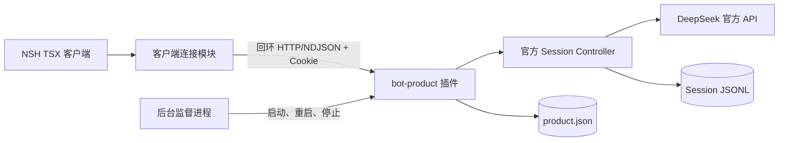

# dsh-bot 架构

本文是工程结构的唯一真源：进程归属、工作区边界、运行时装配与跨进程契约。产品行为见[产品蓝图](BLUEPRINT.md)，术语见[术语表](../GLOSSARY.md)，上游证据与验证状态见 [docs/research](research/)。

状态：三工作区、本机文本对话与 macOS 成品后台已实现并通过确定性验证。现有代码仍按"一个 Bot 多个独立会话"实现，蓝图目标为每个 Bot 单一对话入口，重建尚未开始。真实模型、移动端、正式签名发布尚未验收。

## 1. 系统概览

不变量：客户端不操作 Harness 内部对象，也不裁决执行状态；后台是唯一事实来源。即使客户端与后台同机，也走认证接口而非进程内调用。

## 2. 进程与工作区

| 位置                     | 责任                                                          |
| ------------------------ | ------------------------------------------------------------- |
| apps/client              | NSH TSX 三栏界面、连接、展示状态与平台适配                    |
| apps/runner              | Node 入口、命名 profile 启动、后台监督、Bot 产品插件与持久化  |
| packages/harness-runtime | 固定 Harness 依赖、基础服务 bundle 与随包运行资源定义         |
| scripts                  | 构建、客户端准备、macOS 组装与成品验收脚本                    |
| references               | 固定提交的上游参考，只读研究，不参与安装、导入和打包          |

只维护这三个工作区和根 `bun.lock`。Bun 负责依赖与脚本调度，NSH 运行客户端，Node 运行后台。产品模块先在 `apps/runner` 内组织，出现实际复用或独立装配需求后再提取；客户端不导入后台实现，当前不单独提取契约包、UI 包或 SDK。产品安装、源码导入、类型配置与打包均消费 npm 公开产物，不从 `references` 导入产品代码。

## 3. 运行时装配：profile 与 bundle

`apps/runner/src/index.ts` 准备隔离的命名 profile 后，通过 Harness npm CLI 启动：

- 数据目录默认 `~/.dsh-bot-nsh`，可用 `DSH_BOT_HOME` 覆盖；profile 为 `$DSH_BOT_HOME/profiles/dsh-bot`，与用户已有的 `dsh` 数据完全隔离。
- profile 清单声明 bundle 顺序 `@deepseek-ai/dsh-base` → `@dsh-bot/harness-runtime` → `@dsh-bot/runner`，启动命令为 `dsh --profile dsh-bot`。
- `@dsh-bot/harness-runtime` 与 `@dsh-bot/runner` 通过符号链接进入 profile 的 `node_modules`，使上游解析器从同一依赖图发现 DSH 与产品包。

`packages/harness-runtime/cordis.patch.yml` 只做两件事：补齐独立装配所需的服务（`connection`、`remotes`、`workspace`、文件引用与上传、`session-controller`、`settings-controller`、`agent-preset-registry`），并关闭首版不需要或不允许的能力。首版显式关闭全部工具插件、技能、子代理、workflow、计划模式、压缩与 HMR，`approval` 固定为 `policy: never`，`permission` 整个停用：需要交互审批的操作直接失败，不留下无人回答的审批。

`apps/runner/cordis.patch.yml` 只插入独立 WebServer（`127.0.0.1`，端口 0）与 `bot-product` 插件。模型循环、队列、取消、历史与会话持久化全部由上游承担，产品不实现第二套执行引擎，也不写平行对话日志。

不加载官方 `dsh-web-app`：其页面、`webStartup` 参数解析、前端资源与浏览器自动打开都不使用。当前 `@deepseek-ai/dsh` launcher 直接依赖该包，因此依赖树仍包含它；本项目不改 launcher 分支，只保证自己的 profile 装配与页面交付独立。

## 4. Bot 与对话配置

产品以具名 Bot 为入口。Bot 保存稳定身份、名称与默认执行配置（模型、指令、工作目录）；每个 Bot 只有一个对话，对应一个 Harness Session，对用户表现为一条连续消息流，不提供新建或切换。

首次打开 Bot 时初始化该对话：工作目录默认取 Bot 的目录，模型、指令、能力与工作目录具体化为对话配置并固定。初始化失败可重试；重复初始化请求复用已绑定的对话，不创建第二个执行上下文。

Bot 配置更新不替换已有对话的 Agent，需在空闲时显式应用（见第 5 节）；应用后仍是同一对话与同一 Session，历史保留。配置快照不冻结凭据、插件实现或引擎版本。恢复时使用对话保存的配置；配置无效或插件缺失必须报告失败，不能静默回退到最新 Bot 默认值。

初始化实现为两步：先以 `bot-<bot id>` 注册对话专属 preset（内容为 `@dsh-bot/runner/conversation` 加对话配置），再调用 `sessionController.create` 并用 `selectModel` 固定 `deepseek-official` 提供方下的模型，绑定与配置写入产品存储供后续复用。Bot 模板是产品概念，preset 是 Harness 运行时装配；模板在初始化时复制为对话自身配置，不共享可变状态。

## 5. 配置保存的生命周期

保存配置要求销毁旧 Agent 并在同一 Session 上恢复新 Agent，而销毁会取消并清空 inbox；维护期对外仍显示空闲，读取历史还可能触发冷恢复。因此不能立即应用时**直接拒绝并说明原因**，不设"已保存待应用"的排队状态——那会让保存返回成功但配置未生效。

| 阶段             | 含义                       | 保存配置                               |
| ---------------- | -------------------------- | -------------------------------------- |
| 尚未初始化       | 没有 Agent                 | 可直接应用：写入配置后用新配置恢复     |
| 空闲             | 无执行、无维护             | 可直接应用：写入 → 销毁旧 Agent → 恢复 |
| 执行中           | 有活动轮次                 | 拒绝                                   |
| 占用空闲期做维护 | 压缩等维护任务持有空闲窗口 | 拒绝                                   |
| 正在更换 Agent   | 已开始替换                 | 拒绝                                   |
| 恢复失败         | 新配置及旧配置恢复均失败   | 停止接纳，报告故障                     |

拒绝原因分为：执行中、仍有待处理输入、维护占用空闲窗口、已有一份配置正在应用、执行已停止接纳。客户端只需区分"已生效"与"未生效"两种结果。

配套规则：停止执行保留待处理输入，因此停止后保存仍被拒绝，撤回输入后才能成功；更换期间读取历史被拒绝，避免出现第二个 Agent 所有者；新装配失败时恢复旧配置及其 Agent；恢复失败则停止接纳，客户端不得显示新配置已生效。协调规则的原型与裁决记录见[生命周期原型记录](research/agent-lifecycle-prototype.md)。

## 6. 输入、权限与恢复

- 普通发送使用 Harness queue，显式追加使用 steer，不另建客户端调度器；界面入口保持简单，不建设独立工具或队列详情面板。
- 后台裁决输入接纳，本地展示不能代替接纳确认。未收到确认的提交显示结果未知，需核对后台状态，**不得自动重发**。
- 停止当前执行、撤回待处理输入与停止后台是三种不同操作；停止当前执行不默认撤回待处理输入。
- 首版不提供审批交互。去掉审批界面不等于放行工具：需要审批的操作被拒绝，不能静默扩大授权。
- 客户端断线或关闭不停止后台已接纳的执行。后台异常退出后自动重启并恢复持久历史，但不自动续跑、不重放输入或工具；未完成执行显示中断。用户主动停止后台后保持停止。
- 仅支持 DeepSeek 官方 API。凭据由后台经 Harness 解析：已保存凭据优先，其次 `DEEPSEEK_API_KEY` 环境变量，`.env` 为后备。客户端只经 `credentials.describe` 查看状态与来源，不能读取密钥值，也不提供输入或保存入口；Bot 与对话不复制凭据，修改环境变量后需重启后台。

## 7. 跨进程契约

客户端在 NSH QuickJS 中运行，标准 WebSocket 无法携带官方认证头，因此在 Node 侧提供必要的 HTTP/NDJSON 适配——这是传输适配，不是第二套业务协议：模型、队列、取消与历史仍调用官方 Session Controller。

- 客户端只接受 `http:` + `127.0.0.1` 的启动 URL，通过官方 `/connect` 握手（期望 303 + `Set-Cookie`）取得 owner Cookie，并保存在内存中（原生 `fetch` 不共享浏览器 Cookie 罐）。socket 失效或后台实例变化后需重新认证。
- 后台在 `$DSH_BOT_HOME/connection.json` 发布 `{ pid, url }`（含认证信息的回环 URL，`0600`），插件卸载时删除；该文件与日志不得提交或打印。
- 产品接口：`GET /api/bot/state`、`POST /api/bot/config`、`POST /api/bot/conversation`（幂等：确保该 Bot 的对话已初始化）、`POST /api/bot/prompt`（`mode: queue | steer`，幂等 `requestId`）、`POST /api/bot/cancel`、`GET /api/bot/follow`（NDJSON，带 assistant 增量与 `maxMessages` 上限）、`GET /api/bot/credentials`、`POST /api/bot/shutdown`。全部由上游 `connection.fetch` 的认证与路由承载。
- 跨进程输入由接收端校验：文本长度上限、`requestId` 形如 `[a-zA-Z0-9-]{1,100}`、`mode` 白名单、Bot/对话存在性，失败返回 400 与错误文案。

## 8. 持久化与并发归属

| 数据                        | 所有者                                        |
| --------------------------- | --------------------------------------------- |
| Bot 与对话绑定、对话配置    | `apps/runner/src/store.ts`（`product.json`）   |
| 对话内容、事件、执行历史    | 上游 Session 服务与 JSONL 插件                 |
| 凭据                        | 上游 credentials 服务                          |
| 监督锁与日志                | `apps/runner/src/service.ts`（`supervisor.json`、`runner.log`） |

`store.ts` 只保存产品事实，不保存聊天内容；产品不额外维护供界面读取的平行日志。客户端状态不能替代后台事实。

监督进程以 `supervisor.json` 做单实例认领（写入后复核 pid 归属），为工作进程建立独立进程组，失败按退避重启，`stop` 通过进程组终止，`POST /api/bot/shutdown` 向监督进程发 `SIGTERM` 实现显式停止。客户端断开不触发后台退出。

## 9. 打包与交付

`scripts/package-macos.ts` 组装官方 NSH 应用、内置 `Runner.app` 与已安装的生产依赖闭包，**不携带 Node**，也不重新解析依赖版本。`scripts/node-launcher.sh` 通过用户登录交互 Shell 检测本机 Node，要求 24.9.0 或更新稳定版；开发客户端与成品助手共用该逻辑，不提供手动路径设置。`scripts/smoke-package.ts` 在迁移后的目录与受限 PATH 下验证本机 Node 检测、成品后台与 LaunchServices 助手启动。

与已确认的 launchd 所有权决策的差异：进程监督目前由 `apps/runner/src/service.ts` 承担，launchd 尚未接入；接入时替换的是监督实现，不是产品接口。该决策原文已随旧文档删除，未在新 ADR 重建前以本文第 2、8 节为准。

## 10. Harness 复用边界与已废弃方案

复用的是公开 npm 插件与启动机制：profile 加载、bundle 装配、`runProfile` 的解析与故障表达、Session Controller、认证 Remote、持久化与凭据。产品只补充 Bot 身份、单一对话归属、初始化时固定的配置，以及必要的传输适配。

已废弃的做法与原因：

- 自建 Electron/React 桌面与 `apps/desktop-host`：改为 NSH 客户端加独立 Node 后台，界面与执行分属不同运行时。
- 以 `BotController` 作为 Remote owner 委托官方 Controller：改为 `bot-product` 插件自持产品状态、直接调用 `sessionController`，不引入补丁版 Controller 与生成 Remote 的构建链。
- 保存配置排队待应用：会让保存成功而配置未生效。
- 自行编译 Rust 或包装自有运行时：直接使用 NSH 官方预编译运行时。
- 提取独立的 `bot`/`ui`/`shared`/`web`/`mobile`/`relay` 包：当前无实际复用或独立装配需求。

## 11. 未验证边界

以下结论尚不可被引用为已成立：单一对话入口模型（现有代码为多会话）；真实模型请求；运行中 queue/steer 的完整交互；工具权限与"拒绝待审批操作"的实际路径（首阶段未加载工具）；移动端认证与重连（当前回环限制不能直接用于手机）；launchd 监督与登录自启；全新机器安装、Intel macOS、Developer ID 签名与公证。本机开发验收与成品后台验收不等于全部产品目标达成；命令与运行限制见[根 README](../README.md)，分项验证范围见 [docs/research](research/) 与 [apps/runner](../apps/runner/README.md)。
