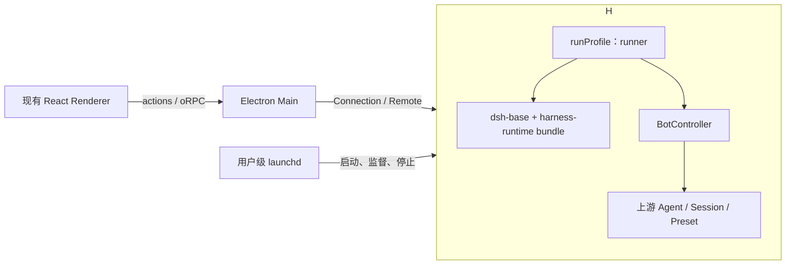

# Harness 到 dsh-bot 的映射方案

本文基于固定上游 `0.2.1-rc.2` 说明本项目的复用方案。Runner profile、Bot Remote、配置事务、同一 Session 替换及进程重启路径已实现；标准 Session Controller 已通过受版本锁定的 Host 扩展协调；桌面接入、launchd 和安装交付仍待后续票。源码依据见 [Desktop Host 调研](./DESKTOP_HOST_RESEARCH.md)；产品要求与进程所有权仍以 [产品蓝图](./PRODUCT_BLUEPRINT.md) 和 [launchd ADR](./adr/0002-launchd-owned-runner.md) 为准。

## 推荐选择

沿用官方 Desktop Host 的 profile 启动机制，应用保持 `apps/runner`，profile 命名为 `runner`。不加载官方 `dsh-web-app` 或官方前端；桌面界面使用现有 React 应用，后续 Web/PWA 由 `apps/web` 自建。执行和通信能力继续复用公开 npm 插件，应用通过标准 bundle 声明需要的组合。

Runner 是实际运行的后台应用，目标由 launchd 管理。Host 表示 Runner 中承载 Cordis 插件树的执行侧环境，沿用上游术语，但不单独建立 `desktop-host` 应用。`packages/harness-runtime` 是依赖与运行资源包，不是另一个进程。

## 目录和名称逐项对应

| 上游                                                   | 本项目建议                          | 处理方式                                                                  |
| ------------------------------------------------------ | ----------------------------------- | ------------------------------------------------------------------------- |
| `apps/desktop`                                         | `apps/desktop`                      | 保留现有 Electron/React 应用和受控 IPC                                    |
| `apps/desktop-host`                                    | `apps/runner`                       | 复用公开 npm 启动机制；由 launchd 管理                                    |
| `desktop-host/src/index.ts`                            | `runner/src/index.ts`               | 沿用加载 profile、调用 `runProfile`、检查就绪和报告故障的顺序             |
| `desktop/src/project-manager.ts`                       | `desktop/src/project-manager.ts`    | 在需要桌面管理安装/profile 时采用同名职责，调用上游 profile helpers       |
| `desktop/src/paths.ts`、`runtime-tree.ts`              | 桌面打包与安装中的同名职责          | 按实际交付需要建立；不提前复制整套上游发布系统                            |
| `desktop/src/host-process.ts`                          | 桌面本机 Runner 管理模块            | 参考控制结果与错误表达；不用其父子进程所有权，名称按实际 launchd 职责确定 |
| `dsh-base`、独立标准插件                               | 原 npm 包名                         | 复用共享基础层，按需装配通信和 preset 插件；不加载 `dsh-web-app`          |
| `dsh-app-boot`、`dsh/profile-boot`                     | 原 npm 导入路径                     | 直接调用，不再包装一套启动框架                                            |
| `dsh-api-session-controller` 的 Controller/Remote 约定 | `packages/bot` 中的 `BotController` | 产品 Remote owner，使用 `ctx.botController`、Remote namespace `bot`       |
| `dsh.bundle.patch`、`cordis.patch.yml`                 | 同名字段与文件                      | runtime 包声明基础服务补充，Bot 包声明产品插件；均使用标准 bundle         |
| 官方测试模型 adapter                                   | Host 的测试 fixture + overlay       | 通过 `ctx.llm.registerAdapter` 注册，仅在测试加载                         |
| 安装版本与资源清单                                     | `packages/harness-runtime`          | 保留当前固定依赖职责，不把它发展成另一套 Host 服务实现                    |

上游 Controller 约定来自 [Remote cookbook](../references/deepseek-harness/docs/cookbook/adding-a-remote-api.md)；应用启动与资源职责来自 [Host 入口](../references/deepseek-harness/apps/desktop-host/src/index.ts)、[profile 管理](../references/deepseek-harness/apps/desktop/src/project-manager.ts) 和 [资源准备](../references/deepseek-harness/apps/desktop/scripts/prepare-dsh.ts)。上游 Desktop Host 清单是私有包，因此复用其启动模式，不能假设可直接安装这个包。

目标目录如下；测试 fixture 和安装脚本只随当前需要建立。

```text
apps/
  desktop/                     # 已有界面、Main、preload、受控 oRPC
  runner/                      # 独立后台应用，由 launchd 管理
    src/index.ts               # 应用 profile 启动桥接
    tests/                     # profile、Remote、实际进程重启测试
      fixtures/                # 确定性 adapter 与测试 overlay
packages/
  bot/
    src/index.ts               # BotController，标准 Cordis 插件入口
    cordis.patch.yml           # 加载 Bot 插件及必要的产品配置差异
    package.json               # dsh.bundle、Host/客户端分离导出
  harness-runtime/             # 固定依赖、基础服务 bundle 与运行资源定义
    cordis.patch.yml           # 标准服务补充及必要的作用域调整
  ui/                          # 已有共享基础 UI
```

## Runner 与 harness-runtime 的关系

| 模块                       | 当前状态                                             | 规划职责                                                                               |
| -------------------------- | ---------------------------------------------------- | -------------------------------------------------------------------------------------- |
| `apps/runner`              | 已有 Node profile 入口与进程契约测试                 | 应用入口、选择 profile、加载 Host、发布就绪与故障、进程级清理；由 launchd 运行         |
| `packages/harness-runtime` | 已有固定依赖、CLI 和基础服务 bundle                  | 固定相容的上游包、声明共享服务 bundle、定义随包依赖资源；不拥有 Bot 状态或进程生命周期 |
| `packages/bot`             | 已有 Controller、storageDomain、preset 与生成 Remote | Bot 档案、配置、Session 关联与 AgentHandle 协调                                        |

Runner 在启动时通过 profile 加载 harness-runtime 提供的 bundle，再加载 Bot bundle；最终所有插件运行在同一 Host 的 Cordis 树中。harness-runtime 不提供第二个 `startHost()`，不自行创建根 Context，也不作为网络服务运行。Node 可执行程序是随安装携带的执行资源，不能将 npm 依赖包本身当作已经打包的 Node 运行时。

## profile 与 bundle

应用使用自己隔离的 `DSH_HOME`，profile 名称为 `runner`，可写目录为 `$DSH_HOME/profiles/runner`。开发、测试、生产各有独立 home，不连接官方 Harness 的默认用户数据。应用使用 `loadProfileDirectory` 加载此目录，以 Runner 的 `package.json` 为 `installAnchor`，让上游解析器从应用依赖图同时发现 DSH 与产品包，然后调用 `runProfile`。复用的是官方应用自有 profile 的加载机制，不要求使用官方应用的 `desktop` 名称。[上游入口](../references/deepseek-harness/apps/desktop-host/src/index.ts)、[app-boot 说明](../references/deepseek-harness/packages/boot/app-boot/README.md)。

profile 的 bundle 顺序建议如下；这是部署 profile 清单的一部分，不是根工作区的依赖清单。

```json
{
  "dsh": {
    "profile": {
      "bundles": ["@deepseek-ai/dsh-base", "@dsh-bot/harness-runtime", "@dsh-bot/bot"]
    }
  }
}
```

`@dsh-bot/harness-runtime` 声明标准 `dsh.bundle.patch`，在 base 上补齐独立 WebServer、Connection、所需 Remote 贡献与 AgentPresetRegistry，并按 Bot preset 调整 base 的全局工具作用域。`@dsh-bot/bot` 的 patch 加载产品插件。测试通过调用时 overlay 更换模型组合。这些都是标准插件装配，模型循环、队列、权限和持久化仍使用上游实现；不是另写执行引擎。

不加载 `dsh-web-app` 后，它提供的 `webStartup` 参数解析、前端资源服务、页面 boot injections 和浏览器自动打开也不再使用。Runner 通过自己的受校验配置提供监听地址等应用参数，通信继续使用独立的 `dsh-host-webserver`、`dsh-client-connection` 和 `dsh-api-gateway`。客户端在 Main 或自建 Web 中装配所需贡献，不依赖官方页面模块清单。具体依赖闭包与激活结果由 #3 的真实 profile 测试确定，不能仅从 Web bundle 删除一行就视为完成。[Connection 独立装配](../references/deepseek-harness/packages/client/connection/README.md)、[上游自有组合示例](../references/deepseek-harness/packages/bundle/sdk-minimal/cordis.patch.yml)。

此处“不使用官方 Web”表示不加载其应用 bundle 或交付其页面。已核对当前安装的 `@deepseek-ai/dsh@0.2.1-rc.2` 清单，它直接依赖 `@deepseek-ai/dsh-web-app@0.2.1-rc.2`；因此依赖树仍包含官方 Web 包。继续消费公开 DSH launcher，同时将本项目的 profile 装配与页面交付独立管理，不为删除这项传递依赖而维护 launcher 分支。

配置 HMR 不能绕过 Bot 严格保存语义；可能自行创建或冷恢复 Agent 的官方接口，在完成统一生命周期协调前不开放给产品调用。只装配需要的 Controller 与标准服务，不引入官方 Desktop 产品遥测和页面能力。

## Bot 插件负责的最小产品差异

`BotController` 按上游 `SessionController` 的方式继承 `TypertRemoteService` 并声明 Remote。Bot 包拥有档案、配置、Bot/Session 关联和其 AgentHandle；Bot 记录使用 Host 已有的 storageDomain 能力，Session 内容继续由标准 Session 服务和 JSONL 插件持有。不要再增加一份供 UI 读取的平行聊天日志。

| 产品行为                 | 直接使用的 Harness 概念                          | 产品需要增加的内容                               |
| ------------------------ | ------------------------------------------------ | ------------------------------------------------ |
| 一个 Bot 持续聊天        | Session、SessionId                               | Bot 到唯一 Session 的持久关联                    |
| Bot 的独立工具与指令     | AgentPresetRegistry、PresetDefinition、作用域    | 稳定的 `dsh-bot:<botId>` preset，具体化 Bot 配置 |
| 创建、恢复与释放执行实例 | AgentRegistry、AgentHandle                       | Bot 所有权、并发操作协调与失败恢复               |
| 发消息、队列与停止       | 公开 Agent 能力；可协调时复用 Session Controller | Bot 身份解析和产品接纳规则                       |
| 历史与执行事件           | Session 查询、投影、标准事件                     | Bot 关联与访问范围，不重定义事件体系             |
| 权限、工具审批、工具执行 | 上游权限、审批与工具插件                         | 按 Bot 配置装配和呈现                            |
| 业务方法与流             | Gateway、Typert Remote                           | `bot` 命名空间、产品字段与错误码                 |

`Bot template` 继续表示产品模板，`Agent preset` 继续表示 Harness 的运行时装配。创建 Bot 时将模板复制为自身配置，再映射为 preset；不能将产品模板直接改名成 preset，避免引入共享可变配置语义。[术语表](../GLOSSARY.md)、[preset 注册说明](../references/deepseek-harness/packages/preset/agent-preset-registry/README.md)。

Bot 包的 Host 实现与客户端贡献分开。沿用上游的 `./typert`、`./remote` 生成入口约定和客户端安全类型入口；普通插件入口只供执行侧加载。独立 npm 工程已通过公开生成器完成生成；npm protocol 识别所需的单行兼容补丁见 [补丁说明](../patches/README.md)，产品构建不依赖参考子模块的脚本。[生成约定](../references/deepseek-harness/docs/cookbook/adding-a-remote-api.md)。

## 生命周期协调的取舍

优先复用 Session Controller 的业务方法，并通过统一委托保持 Bot 的 Agent 生命周期所有权。#5 已在固定 npm 版复现 preset 缺失、官方激活句柄未交给 Bot，以及历史开场绕过替换拒绝；npm 基线的公开接口不足；正式 profile 通过根锁文件中的兼容补丁提供 Host 委托。扩展、替代方案和正向证据见 [Session Controller 共存验证](./SESSION_CONTROLLER_COMPATIBILITY.md)。

Bot Remote 与标准 Controller 共用 Bot 的 AgentHandle 所有者。正式 profile 已装配标准服务及 `@dsh-bot/bot/session-controller`，通过操作窗口保护 lookup、方法使用、历史开场和上传；退出前先排空消费者。产品构建不修改参考子模块或复制 Controller。

标准 create、fork 和 selectModel 在产品 profile 中明确拒绝，避免绕过 Bot 管理；故障或替换中的入口也不能落回官方自动恢复。上游提供等价可消费接口后，统一升级并通过正向契约测试，再移除补丁。

## 进程和客户端映射

目标进程关系如下；桌面 Main 连接和 launchd 安装尚未落地。



Host 启动继续使用上游 `runProfile` 的环境、解析、Loader、故障和 shutdown 机制。只调整桌面专属桥接：客户端断开不触发 Host 退出，桌面连接已有 Host，launchd 承担进程监督。无需为此新增 BotEngine、执行调度器或另一套全局服务容器。

Main 使用 Connection/Gateway 与 Host 通信，再通过现有 oRPC 向 Renderer 提供受控操作和流。保留标准 Remote 的结果、错误和取消语义，oRPC 只承担已有桌面 IPC。Main 的 oRPC Router 不接受任意 Remote 方法名透传；客户端也不取得模型密钥。首次实现需要验证生成客户端贡献和流在 Main 中的实际装配。[既有客户端调研](./HOST_AND_CLIENT_RESEARCH.md)。

上游父子 IPC 的 ready/fatal/shutdown 表达可以参考，但 launchd 不是 Electron IPC 父进程。后台地址、认证与重连需要有独立于某个窗口的本机发现方式；具体文件和凭据布局留在 launchd 票实施，不能把带凭据的 ready 消息原样写成所有进程可读的状态文件。

## 随包运行时

固定 npm 依赖、生产资源物化、目标架构原生依赖、签名及成品 smoke 沿用上游交付原则。开发依赖管理仍使用 Bun；后台执行程序随安装携带，用户不需要系统 Node/Bun/pnpm/dsh。Host 不在启动时从 registry 临时安装核心依赖。[上游资源构建](../references/deepseek-harness/apps/desktop/scripts/prepare-dsh.ts)。

上游 Host 使用 Electron Node 模式，其 primary-runtime 也包含 Node 等离线组件。本项目此前选择独立 Node 后台，建议继续采用随包 Node 并验证 `--expose-internals` 和原生模块，而不把执行程序替换成 Bun。上游 runtime 内含多种 Office 依赖，不能为得到 Node 就不加区分地复制全部资源。此项是交付方案，尚未经过本项目安装包验证。

## 落地顺序与通过条件

| 阶段              | 工作                                             | 通过条件                                                   |
| ----------------- | ------------------------------------------------ | ---------------------------------------------------------- |
| #3：标准插件组合  | 命名 profile、公开 npm、runtime/Bot bundle 加载  | 启动及清理成功，所需服务与 Remote 存在；不是只打开端口     |
| #3：测试执行闭环  | 测试 overlay 注册确定性 adapter，调用 Bot Remote | 流式回复、真实日志、实际进程重启后同 Session 历史均通过    |
| #4：配置事务      | Bot 配置事务、preset 替换、失败回退              | 已验证严格保存、五种拒绝、原 Session 连续及故障保持        |
| #5：生命周期协调  | 官方 Controller 与 Bot 共享 Agent 所有者         | 已通过受补丁约束的冷恢复、长流、异步操作、上传和退出验证   |
| #6 及后续桌面票   | Main 接入与现有 UI 操作                          | 经受控 oRPC 完成对话、工具和审批                           |
| #11/#12：系统交付 | launchd、自带 Node、安装和升级                   | 桌面退出继续执行、异常拉起、主动停止及版本替换均有成品证据 |

手搭的生产 `createBotHost` 已移除，正式启动使用命名 profile，确定性模型仅由测试 overlay 加载。操作和当前验证范围见 [Runner README](../apps/runner/README.md)；原始失败基线见 [#3 失败记录](./DESKTOP_HOST_RESEARCH.md#3-实施前失败证据)。
