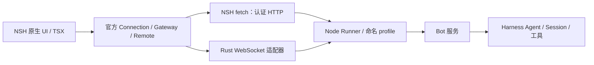

# NSH 与 DeepSeek Harness 通信调研

本文记录全面迁往 NSH 前的接入调查，不表示客户端迁移已经实现。用户接受重建现有 UI 和测试；本轮先确认通信机制与 Harness 衔接。

## 调研基线

- NSH 参考提交：`f5f40ddc822eab3900ec3776afecc9a01801b4ea`。
- Harness 参考提交：`22ddee3792402c3e70ec5f86a63c3e3e895a2f60`；实际 npm 客户端为 `0.2.1-rc.3`，参考源码和发布产物需要分别核对。
- 本机 `nsh --version` 返回 `nsh 0.1.1`，不能将参考源码的功能直接视为该 CLI 已具备的功能。

## 结论

NSH 可以作为新的原生客户端，Runner 继续用 Node 运行 Harness。UI 框架切换不要求重写模型循环、Session、工具执行与 Bot 服务。

优先验证“NSH TSX + 官方 Harness 客户端 + Rust 认证传输适配器”。目前不能宣称纯 TSX 可以直接连接现有 Runner：NSH 的全局 WebSocket 不接收自定义握手头，而 `websocket` 模块明确禁止凭据头。官方客户端的 npm 导出、依赖与 QuickJS 运行兼容性也必须验证。

现有 Electron Main 的本机发现、认证、客户端装配与审批逻辑可作为行为依据，不能把整个文件搬进 NSH VM。当前源码使用 Node 文件系统、`ws` 和 Electron 所属应用边界。

依据：[当前认证客户端](../apps/desktop/src/main/runner-client.ts)、[连接描述文件校验](../apps/desktop/src/main/runner-connection.ts)、[Harness Connection](../references/deepseek-harness/packages/client/connection/README.md)、[Gateway](../references/deepseek-harness/packages/api/gateway/README.md)。

## NSH 如何访问后端

| 机制 | 适用范围 | 对本项目的含义 |
| --- | --- | --- |
| 全局 `fetch` | HTTP、流式响应、取消 | 原生端允许显式 Cookie；`redirect: 'manual'` 可读取 302 和 Location |
| 全局 `WebSocket` | 浏览器形状的事件接口 | 构造器不提供自定义握手头，不能直接发送现有 API Cookie |
| `websocket.WebSocket.connect` | Promise 形式的读、写、关闭 | 可设部分握手头，但拒绝 Cookie、Authorization 等凭据头 |
| `nsh/host` | TSX 与嵌入它的原生宿主通信 | 需自行注册宿主函数；不是现成的 Node/Harness 连接器 |
| Rust `nativeModule` / 应用 Rust 模块 | 自定义本机网络、系统操作 | 可实现受控认证 WebSocket 及本机发现，再向 TSX 暴露小接口 |

NSH TSX 在 QuickJS 中执行，Node 形状的标准模块只支持它声明的 API；不能由“支持 npm”推断任意 Node npm 包都可运行。原生端与 Web 端也不能混为一谈：Web 使用浏览器传输，不能设置自定义 WebSocket 握手头。

依据：[NSH 网络文档](../references/nsh/website/docs/networking.md)、[标准模块](../references/nsh/website/modules/standard-modules.md)、[全局 WebSocket 原生实现](../references/nsh/crates/nsh-js/src/standard/websocket_native.rs)、[显式 WebSocket 选项校验](../references/nsh/crates/nsh-core/src/runtime/websocket.rs)、[宿主通道](../references/nsh/website/modules/nsh-host.md)、[Rust 模块](../references/nsh/website/modules/nsh-native.md)。

## 当前 Runner 的认证和调用链

1. 本机客户端读取私有 `run/connection.json` 链接及实例描述文件，校验所有权、权限和回环地址，取得 `origin`、`connectUrl`、`instanceId`。
2. 请求 `GET /connect?token=…&interactions=answer`，不自动跟随重定向。
3. 验证 302、同源 `/api/remote.mux` 目标和 `Set-Cookie`。后续 HTTP 与 WebSocket 使用同一 API Cookie。
4. 装配 Cordis Context、`installConnection`、TypertRegistry、Gateway，挂载 Bot、Session、Settings 的 Remote 贡献。
5. 普通 Remote 调用经 HTTP；流式调用通过 `/api/remote.mux` 上的多路复用逻辑流传输。审批是服务端转发、客户端回答的事件，需要 `interactions: 'answer'` 和 Session Context 解析。
6. 物理连接中断后不能继续复用旧 API Peer：需要重新认证。客户端观察取消与 Runner 中已接纳任务的停止应保持独立语义。

这是产品现有的非页面认证链。Harness 的普通浏览器页面另有浏览器 Cookie 交换，不能假定 NSH 原生 VM 有浏览器 Cookie jar。

依据：[RunnerClient.authenticate](../apps/desktop/src/main/runner-client.ts)、[RunnerDescriptor](../apps/desktop/src/main/runner-connection.ts)、[Connection 认证与 Peer 所有权](../references/deepseek-harness/packages/client/connection/README.md)、[Gateway 调用、流与事件](../references/deepseek-harness/packages/api/gateway/README.md)。

## 建议的衔接方式

图中客户端装配与 Rust 传输均为待验证方案。

Rust 层优先只负责受控传输、本机发现和系统服务操作。不要在 Rust 重写 Bot 业务规则，也不要重新实现模型循环。`createWebSocket` 适配器需满足 Gateway 实际使用的事件、发送、状态和关闭接口，明确队列上限与清理归属；Cookie 仅允许送往描述文件校验过的 Runner 地址。

上游已有可注入 `fetch`、`createWebSocket` 和 `streamBaseUrl` 的 Connection 机制，优先复用。偏离之处在于 NSH 原生运行时无法直接携带现有 WebSocket Cookie，因此需要本机传输适配。`nsh/host` 可作为自建宿主的桥，但不会自动连到 Node Runner。

若官方客户端因 npm 产物或 QuickJS 兼容性无法以合理成本运行，再评估 Runner 内的薄协议适配插件，调用既有 Bot/Session 服务并映射审批、流和取消；这会新增要维护的协议边界，应在直连实验失败后决定。

## 已执行的客户端打包探测

使用仓库现有 Rolldown，在内存中对最小客户端入口做了 browser 条件打包：

- `@deepseek-ai/dsh-client-connection/client` 解析到 `lib/client.browser.js`，报 `MISSING_EXPORT`：该产物不提供 ESM 的 `installConnection` 导出。
- 检查发布文件可见，browser 产物通过 `window.__ModuleLoader__.load(...)` 注册到 Harness Web 宿主；它不是可直接导入 NSH QuickJS 的通用 ESM。
- 指定 neutral 平台及 `node` / `import` / `default` 条件后，最小装配（Cordis、Connection、Gateway、Registry、Bot/Session/Settings Remote）成功生成约 1.24 MB 未压缩 ESM，没有外部导入、Node 内建模块导入或打包警告。说明官方客户端的复用方向有依据，但仍需在真实 NSH VM 验证。
- 加入完整 `dsh-api-remotes/client` 后也能打包，但会包含 `window.__ModuleLoader__.load(...)`。完整 Web 客户端装配不能直接用于 NSH。

这证明直接套用 browser 导入方案会失败，不代表官方客户端的独立装配不可行。

## 迁移前的验证门槛

1. 固定 NSH CLI/运行时版本，先保证与参考 API 一致。
2. 以实际 npm 发布产物探测官方客户端的打包入口、导出与依赖；通过打包不代表通过 QuickJS 运行。
3. 在 NSH 原生运行时完成认证、Bot 列表与历史读取。
4. 验证真实流式输出、工具事件、审批回答、停止和排队。
5. 验证窗口关闭后 Runner 任务继续，重开恢复历史；Runner 重启后重新发现和认证，不自动重发状态未知的请求。
6. 跑通后替换 Electron UI、preload/oRPC、DOM 组件与相应 E2E。旧测试可以删除；新实现仍需覆盖上述行为契约。

目前完成源码和文档调查、本机 CLI 版本检查、官方客户端 browser 条件打包探测；尚未完成 NSH 到 Runner 的真实连接、QuickJS 客户端执行或 NSH 成品验证。
