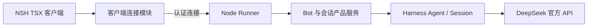

# NSH 从零重建设计

状态：已按确认方案重置工程并实现三个工作区、本机文本对话及 macOS 成品后台。确定性测试、原生界面基础操作和成品后台验收已通过；真实模型、移动端及正式发布尚未验收。开发分支为 `nsh-app`。

## 决策优先级

本文件记录本次重新设计的已确认决定。与旧版产品蓝图、工程方案、界面规范发生冲突时，本次决定优先；旧文档中的实现、测试和打包结论仅作为历史证据，不自动成为新实现承诺。仓库级开发约束仍适用。

保留文档、参考子模块与 Git 历史。旧分支用于回顾旧实现，不在新主线保留旧源码归档，不迁移旧数据。重建前检查分支和未提交内容；删除源码的授权不等于删除参考子模块或用户数据。

## 产品与界面

产品以具名 Bot 为入口。一个 Bot 可以有多个独立会话，每个会话对应一个 Harness Session，可以各自执行。

macOS 首版采用三栏：

| 区域 | 内容 |
| --- | --- |
| 左侧 BotList | Bot 列表、选择、新建 |
| 中间 BotChat | 会话选择、新建会话、用户文本、Agent 文本回复、输入框、发送与停止 |
| 右侧 BotInfo | Bot 名称、默认模型、指令、默认工作目录；区分当前会话的只读实际配置 |

BotChat 顶部提供会话入口，选中 Bot 后恢复上次查看的会话。对话只展示用户消息和 Agent 回复，支持流式文本；不展示工具调用结构、工具结果卡片、推理过程或审批交互。连接失败、执行失败、中断和提交结果未知以必要的简短状态提示表达。

首版不建设 IDE、Dock 工作区、代码编辑器、插件市场、工具配置面板、附件交互或 Relay。移动端先验证最小通信页面，完整移动产品及其布局后续设计。

## Bot 与会话配置

Bot 保存稳定身份、名称和默认执行配置。创建会话时选择工作目录，默认取 Bot 的目录；模型、指令、能力和工作目录具体化为该会话的配置，创建后固定。

修改 Bot 只影响新会话，不替换已有会话的 Agent。已有会话可修改名称等展示信息，但首版不支持执行配置修改。不同 Bot 可以使用同一个目录；目录不等于访问授权，不提供自动 worktree 隔离。

配置快照不冻结凭据、插件实现或引擎版本。恢复使用会话保存的配置；配置无效或插件缺失应报告失败，不能静默改用最新 Bot 默认值。

会话归属与配置由产品服务持久化；执行日志、模型循环、输入队列和工具执行由 Harness 管理，不创建第二套执行引擎或对话日志。

## 输入、权限与恢复

- 普通发送默认使用 Harness queue；显式追加使用 steer，不另建客户端调度器。界面入口保持简单，不建设独立工具或队列详情面板。
- 停止当前执行、撤回待处理输入和停止后台是不同操作。停止当前执行不默认撤回待处理输入，具体接入行为须核对上游并验证。
- 后台裁决输入接纳；本地展示不能代替接纳确认。没有收到确认的提交显示结果未知，核对后台状态，不自动重发。
- 使用固定的内置能力组合，不提供动态插件安装。去掉审批界面不等于放行工具：首版只采用无需交互审批的策略，需要审批的操作直接拒绝，不能留下无人回答的审批。
- 能力允许范围与上述拒绝路径必须在接入实验中核实；不能仅依赖客户端隐藏审批，也不能静默扩大授权。
- 客户端断线或关闭不停止后台已接纳的执行。
- 后台异常退出后自动重启；恢复持久历史，但不自动续跑、不重放输入或工具。未完成执行显示中断。
- 用户主动停止后台后保持停止；登录自启是独立可选设置。

首版仅支持 DeepSeek 官方 API。模型凭据只保存在后台，复用 Harness 凭据机制；客户端可以提交密钥和查看可用状态，不能读取已保存密钥。Bot 和会话不复制凭据。更新密钥不视为修改会话配置。

## 运行架构



客户端与后台即使同机也通过认证接口通信。客户端页面不直接操作 Harness 内部对象，也不负责执行状态裁决。

不维护自定义 Rust 代码；使用 NSH 官方预编译运行时。Bun 管理依赖，Node 执行后台，Harness 经命名 dsh profile 启动。运行时使用 npm 公开入口，不从 references 导入产品代码。依赖版本与兼容性在最小实验中锁定。

优先验证官方客户端在 NSH QuickJS 中运行。若不能满足认证、流式和恢复需求，在 Node 侧提供必要适配；适配不得复制 Harness 的模型循环、队列或持久化语义。最终传输和适配边界由实验决定，暂不提前承诺自定义业务协议或 SDK 包。

### 上游依据与产品补充

- `references/deepseek-harness/packages/client/connection/README.md`：已有 Remote 调用、传输注入与连接恢复机制；非页面认证调用通过 `/connect` 交换 API Cookie，物理连接结束后需重新建立身份。标准 WebSocket 可用不等于 NSH 已完成认证接入。
- `references/deepseek-harness/packages/api/session-controller/README.md`：已有会话创建、恢复、prompt、历史和实时状态投影。优先复用其执行与历史语义；产品服务补充 Bot 身份、多会话归属及创建时配置固定的规则。
- `references/nsh/examples/gallery/demos/Chat.tsx`：已有 NSH 聊天展示参考，但包含本产品不需要的工具与复杂交互；只参考基础消息、滚动和流式文本。
- `references/nsh/examples/gallery/demos/StandardWebSockets.tsx`：提供标准 WebSocket 和模块接口示例，但不能证明 Harness 的 Cookie、HTTP 与重认证路径已兼容。

此前研究见 [NSH 与 Harness 通信调研](./NSH_HARNESS_RESEARCH.md)。该文中的审批往返不再是首版交付项，历史调查结果不等于新实现已验证。

## 最小工程边界

```text
apps/
  client/                 NSH TSX 页面、客户端状态、连接与平台适配
  runner/                 Node 入口、命名 profile、后台生命周期及 Bot 产品模块
packages/
  harness-runtime/        固定 Harness 依赖及运行时资源
scripts/                  实际需要的构建、组装与验收脚本
docs/
references/
```

只建立上述三个工作区；Bot 业务先在 apps/runner 内组织，出现实际复用或独立装配需求后再提取包。不提前建立独立 bot、ui、client-sdk、web、mobile、relay 或 vendor 声明包。

安装包统一交付 NSH 客户端、Node 后台及依赖；用户无需另装 Node、Bun 或 dsh。客户端提供后台启动、停止和状态查看。后台独立于窗口存活，但随客户端统一发布，不独立自动升级。

## 删除与文档整理范围

删除旧 Electron/React 应用、旧 Runner 与 Bot 实现、旧 UI 包、旧 vendor 构建副本、旧测试、旧依赖清单和构建发布配置。脚本、锁文件、CI、类型与 lint 配置依据新工程重建，不能遗留调用已删除工作的入口。

文档保留，但旧蓝图和布局必须更新为新规格或明确标记历史；旧 Electron/shadcn 专属规则不约束 NSH。准确文案、清晰焦点、状态可信等通用原则继续适用。删除或重建 AGENTS.md 时遵守对应 agent 文档编写规则，避免继续引导代理进入已删除目录。

不删除 `.git`、参考子模块、保留的文档或用户运行数据。旧数据不自动导入，新实现使用隔离的数据目录，正式路径在启动实验中确定。

## 实施顺序与验收

### 1. 重置工程

核对当前分支和旧分支的可回顾性，保留未提交的调研文档，删除旧实现与旧测试，重建最小根清单和真实可执行的脚本。不要为了维持旧测试而保留兼容层。

### 2. 验证最小接入

用最小 NSH 页面与命名 profile 后台验证：

- 认证连接、真实模型文本流、停止及持久历史读取。
- 关闭客户端后执行继续，重开读取同一后台的状态。
- 断线及后台重启后重新认证，区分历史恢复与中断，未确认请求不重发。
- 不产生等待客户端回答的审批；需要审批的操作明确拒绝。
- 统一 NSH CLI、预编译运行时和参考版本基线，不以不同版本的模拟结果替代验证。
- 打包携带 Node 后台与资源，在没有外部运行时的环境验证启动；无法提供该环境时明确记录未验证。
- 移动端最小页面的认证、流式文本和重连；受签名或设备条件限制的结果明确标记。

官方客户端直连和 Node 适配均须以实际结果选择，失败要记录实际原因。

### 3. 实现最小产品

在实验确定的连接边界上实现 Bot、多会话与固定配置、三栏界面、凭据设置和后台管理。不引入旧版配置替换事务，不建设复杂工具展示。

### 4. 验证成品

旧测试全部删除，不迁移旧断言或以旧测试数量为目标。新验证直接服务已确认行为：会话隔离、配置固定、queue/steer、停止、拒绝待审批操作、断线恢复、独立后台和打包启动。验证使用确定性执行与真实模型各自覆盖的证据，分别报告。

## 当前状态

已核对 `nsh-app`、`main` 与 `recovery/toolchain-wip-20261026` 分支，保留调研文档与参考子模块，清除旧源码和旧测试。`apps/client`、`apps/runner`、`packages/harness-runtime` 已建立并接入实际脚本。

- 采用官方 Cookie 认证与 Node HTTP/NDJSON 适配；模型、队列、取消和历史仍调用官方 Session Controller。客户端只允许本机回环地址。
- 已通过确定性模型接口下的真实 Harness 测试：认证拒绝、文本增量、会话隔离、指令与模型配置、默认配置更新不影响已有会话、取消及重启读取历史而不重放输入。
- 已通过监督进程并发启动、工作进程强制终止后恢复、旧安装路径更新和认证主动停止测试。
- NSH 页面与文本投影测试通过；macOS 原生测试验证创建 Bot、保存和创建会话。成品原生窗口已实际打开并连接已有后台，尚未验证成品界面中的全部操作。
- `bun run package:macos` 组装官方 Node 24.15.0 与当前已安装的依赖版本。`bun run test:package` 将成品移出仓库，在全新数据目录、系统 PATH 下验证认证、故障恢复、停止，并实际调用 LaunchServices 启动内置助手。当前产物约 726 MiB，尚未裁剪。
- 本机 CLI 是 `nsh 0.2.0 (68531fb)`，参考子模块是 `f5f40ddc822eab3900ec3776afecc9a01801b4ea`，两者并未统一到同一提交；本次运行结论仅针对实测 CLI/预编译运行时。未自行编译 Rust。

尚未验证：真实模型请求、运行中 queue/steer 的完整交互、移动端认证与重连、全新机器安装、Intel macOS，以及 Developer ID 签名和公证。首阶段没有加载工具，因此不把文本测试视为工具权限或拒绝审批操作的验收。完整移动通信需要后续远程接入设计，目前回环限制不能直接用于手机。

本机开发与成品后台验收并不等于所有产品目标完成。命令与运行限制见 [README](../README.md)。
