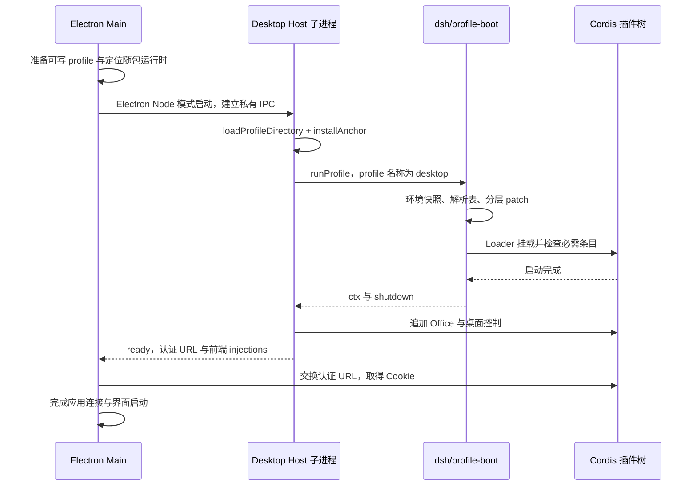

# Desktop Host 启动链与 Runner 复用调研

本文核对参考子模块提交 `687f282e8625c6b8d11ff58211a90524be2e4317`（DSH `0.2.1-rc.2`），沿 Desktop → Desktop Host → profile → 插件树追踪运行、通信、资源与退出。结论来自固定版本源码；本次没有启动上游完整桌面、制作 Runner 安装包或验证 launchd。#3 实施前的失败基线保留在文末；当前 Runner 实现与验证范围见 [Runner README](../../apps/runner/README.md)。

## 结论与职责

`apps/desktop-host` 是官方 Electron 应用的执行侧入口，但完整运行能力由 `@deepseek-ai/dsh/profile-boot` 和 profile 选择的 bundle 提供。入口加载应用自己的 profile，启动标准插件树，追加桌面专属资源与控制，再将连接信息报告给 Electron。模型循环、Session 日志、工具和 API 实现不在这个入口中。[入口源码](../../references/deepseek-harness/apps/desktop-host/src/index.ts)、[profile 启动](../../references/deepseek-harness/apps/cli/src/profile-boot.ts)。

本项目应复用命名 profile、公开插件和运行时解析机制，保留独立 Runner 应用。必须调整的是进程所有权：官方 Desktop Host 由 Electron 启动，父子 IPC 断开时自行停止；本项目已经决定由 launchd 管理 Runner，桌面退出后继续运行。这个差异不需要重写 Agent Loop，也不能通过原样使用 Desktop Host 入口解决。[Host 进程管理](../../references/deepseek-harness/apps/desktop/src/host-process.ts)、[Host 断连处理](../../references/deepseek-harness/apps/desktop-host/src/index.ts)、[本项目 ADR](../adr/0002-launchd-owned-runner.md)。

| 层                                | 上游所有者                                | 本项目复用或调整                                                 |
| --------------------------------- | ----------------------------------------- | ---------------------------------------------------------------- |
| Electron 窗口与后台连接           | `apps/desktop/src/main.ts`                | 保留现有 Electron/React、actions/oRPC 与 Main；Main 管理本机连接 |
| 进程创建与停止                    | `DesktopHostProcess`                      | 参考就绪、失败和有序停止处理；Runner 所有权改为 launchd          |
| 应用启动桥接                      | `apps/desktop-host/src/index.ts`          | 参考应用 profile 与安装锚点；不照搬父 IPC 断开即退出             |
| profile 装配与进程级清理          | `dsh/profile-boot`、`dsh-app-boot`        | 消费 npm 公开入口                                                |
| 执行与持久化                      | profile 装配的 Agent、Session、工具等插件 | 复用上游实现                                                     |
| Bot 档案、配置及唯一 Session 关联 | 上游没有本项目的 Bot 产品规则             | 产品插件负责，并协调其 AgentHandle                               |

## 启动路径

### 1. 分开定位不可变运行时和可写 profile

Electron 的 `runtimeResources()` 使用 `process.execPath` 作为 Host 执行程序；DSH 包目录在打包后位于应用的 `dsh` 资源中，开发环境则可使用准备好的开发目录。`resolveDesktopPaths()` 将可写 Desktop profile 放在 Harness home 的 `profiles/desktop` 下。两者用途不同：前者提供随版本发布的代码，后者保存插件选择与用户 patch。[资源定位](../../references/deepseek-harness/apps/desktop/src/main.ts)、[可写目录](../../references/deepseek-harness/apps/desktop/src/paths.ts)。

`DesktopProjectManager.applyRelease()` 读取 runtime 描述、初始化 profile 并清理旧解析链接，不在每次启动时安装核心依赖。初始化使用 `PROFILE_TEMPLATES.web.bundles`，即 `dsh-base` 加 `dsh-web-app`；`desktop` 是此应用调用 `runProfile` 时给出的 profile 名称，不是另一个内置的 `PROFILE_TEMPLATES.desktop`。[profile 管理](../../references/deepseek-harness/apps/desktop/src/project-manager.ts)、[模板定义](../../references/deepseek-harness/packages/boot/app-boot/src/profile.ts)。

### 2. Electron 使用自己的 Node 模式运行 Host

`DesktopHostProcess.start()` 用 Electron 可执行程序启动 `@deepseek-ai/dsh-desktop-host/lib/index.js`，设置 `ELECTRON_RUN_AS_NODE=1`，传入 `--expose-internals`、运行时目录、profile 目录与可选的包管理器资源。子进程 cwd 是 profile 目录，stdio 包括独立 IPC 通道。它没有调用用户系统安装的 `node` 或全局 `dsh`。[进程启动](../../references/deepseek-harness/apps/desktop/src/host-process.ts)、[Node 模式环境](../../references/deepseek-harness/apps/desktop/src/node-environment.ts)。

本项目要求随安装提供可独立运行的 Runner，因此需要验证选定执行程序、模块解析和原生依赖的实际交付。上游 Electron Node 模式证明了一种随应用携带执行程序的方式；它不等于本项目已经完成独立 Node 供给、launchd 启动或升级后的运行时替换。

### 3. Host 明确提供安装锚点和应用 profile

Host 以运行时中的 `node_modules/@deepseek-ai/dsh/package.json` 作为 `installAnchor`，调用 `loadProfileDirectory('dsh', projectDir, installAnchor)`，报告被跳过的 bundle，再通过 `resolvedProfile` 传给 `runProfile`。这允许应用拥有 profile 目录，同时从随应用安装的 DSH 包集合解析标准插件。[Host 入口](../../references/deepseek-harness/apps/desktop-host/src/index.ts)、[应用 profile 与解析机制](../../references/deepseek-harness/packages/boot/app-boot/README.md)。

启动参数固定使用 `--no-open --host 127.0.0.1 --port 0`：监听本机随机端口，不打开系统浏览器。`runProfile` 将应用参数作为 `ctx.cmdlineArgs` 提供给插件，具体 Web 参数由 bundle 的 startup 插件解释。可选包管理器配置仅提供给插件包操作，不改变产品工作区使用 Bun 的约束。[Host 调用参数](../../references/deepseek-harness/apps/desktop-host/src/index.ts)、[Web startup 装配](../../references/deepseek-harness/packages/bundle/web-app/cordis.patch.yml)。

### 4. profile boot 承担完整装配和失败清理

`runProfile` 先安装启动环境快照对应的代理，再计算 runtime resolution、读取分层 patch，通过 `boot()` 挂载树。挂载前提供 `profileContext`、启动环境、PluginPackages 和命令行服务；初始树完成并符合条件后提交 launcher 的 `appReady`。返回值包含 `ctx` 和进程级 `shutdown`。[完整实现](../../references/deepseek-harness/apps/cli/src/profile-boot.ts)。

patch 顺序为 bundle 声明顺序、profile 的 `cordis.patch.yml`、Harness home 的 `cordis.patch.yml`、调用时的 overlays，最后叠加 telemetry 环境开关。按 id 替换的 `config` 是完整替换，不是深合并；插件行的排列顺序不等于服务激活顺序，注入依赖决定何时能激活。[装配实现](../../references/deepseek-harness/apps/cli/src/profile-boot.ts)、[app-boot 说明](../../references/deepseek-harness/packages/boot/app-boot/README.md)、[base 配置说明](../../references/deepseek-harness/packages/bundle/base/cordis.patch.yml)。

runtime resolution 在 profile 插件导入前建立，负责安装侧与 bundle 依赖的选择及共享 peer。它使用 Node 内部模块解析机制，相关运行时与原生支持必须纳入成品验证。只在测试中 `new Context()` 后逐项挂载服务，不会自动获得这些应用启动语义。[运行时解析说明](../../references/deepseek-harness/packages/boot/app-boot/README.md)。

启动成功也有范围：app-boot 对一组已知 required entry id 执行启动检查，普通非必需插件失败可以只产生警告。产品 Bot 插件是否成功加载、Remote 是否可调用仍需显式验证，不能只凭进程存活或端口打开判定 Runner 就绪。[启动与重载失败策略](../../references/deepseek-harness/packages/boot/app-boot/README.md)。

### 5. 桌面扩展完成后才报告 ready

`runProfile` 返回后，Host 安装更新接纳控制、退出检查、Office 资源插件与 Platform 会话发布，再从 Connection 取得认证 URL，将它与 `collectIndexInjections()` 的结果通过 IPC 发给 Electron。launcher 的 `appReady` 与 Electron 收到的 `ready` 是两个阶段；后者包括 Desktop Host 追加装配。[Host 入口](../../references/deepseek-harness/apps/desktop-host/src/index.ts)。

本项目就绪条件需要覆盖所交付的 Bot 服务和通信路径；不必为了得到一个就绪信号就装入官方 Office 或前端。

## bundle 中真正值得复用的运行机制

`dsh-base` 提供 LLM、Session、投影、JSONL、工具、权限审批、存储、Gateway 等共享能力。`dsh-web-app` 在其上增加 Web 监听、Connection、Session Controller、Workspace、官方客户端模块和其他 GUI 服务。这是官方桌面拥有完整执行能力的装配来源。[base 配置](../../references/deepseek-harness/packages/bundle/base/cordis.patch.yml)、[Web 配置](../../references/deepseek-harness/packages/bundle/web-app/cordis.patch.yml)、[Web bundle README](../../references/deepseek-harness/packages/bundle/web-app/README.md)。

Web overlay 还调整 Agent 作用域：禁用 base 中多种全局工具、指令与压缩等条目，再安装 AgentPresetRegistry，通过独立 preset patch 为每个 Agent 装配能力。Jobs、Skill 等跨会话共享服务保留在 Host；各 Agent 可见的工具和部分提供者在其 preset 作用域内。Bot 独立配置必须保留这种职责划分，只在全局 Context 增删工具并不等价。[Web 的作用域调整](../../references/deepseek-harness/packages/bundle/web-app/cordis.patch.yml)、[preset patch 声明](../../references/deepseek-harness/packages/bundle/web-app/package.json)。

采用完整 Web bundle 也会带入官方浏览器模块、前端资源、Settings 和 Session 控制等组合，不能把它当成单纯的无界面 Host 内核。本项目可以先用它作兼容性基线，但默认产品组合是否保留这些条目，应按当前 React UI 和 Bot 生命周期需求决定。自有 bundle 仍可以引用标准插件；官方 `sdk-minimal` 就以独立 bundle 显式列出服务，没有叠加 `dsh-base`，说明完整 profile 不要求固定使用 base-plus-web 组合。[Web bundle 职责](../../references/deepseek-harness/packages/bundle/web-app/README.md)、[独立最小组合示例](../../references/deepseek-harness/packages/bundle/sdk-minimal/cordis.patch.yml)。

官方 Session Controller 的冷恢复和 Agent 所有权问题仍然存在。把它加载进 Runner 并不会自动让产品取得 AgentHandle；也不能让历史 follow 在产品配置替换窗口绕过 Bot 生命周期协调。此处沿用已有 [Remote/API 接入约束](./HARNESS_INTEGRATION.md#remoteapi-接入约束)，本次源码调研没有解决该组合问题。

## 两条不同的通信路径

| 路径                             | 上游用途                                                   | 与 Bot 业务调用的关系                           |
| -------------------------------- | ---------------------------------------------------------- | ----------------------------------------------- |
| Electron ↔ Host 私有进程 IPC     | ready、fatal、shutdown、更新检查、退出检查及 Platform 会话 | 进程控制与桌面集成，不承载聊天的通用 Remote API |
| 客户端 ↔ Host Connection/Gateway | 认证的业务方法、历史、状态和流                             | 产品服务应使用的标准调用体系                    |

Host 将带进程 token 的 URL 仅交给 Electron。Main 用它交换 Cookie，保存 Host 地址与 Cookie；应用静态资源从本地加载，其余请求经 Main 转发，转发响应过滤 `set-cookie` 等头。WebSocket 则由 Main 对属于当前窗口、匹配 Host 地址与应用 Origin 的请求补充认证头。[认证与 HTTP 转发](../../references/deepseek-harness/apps/desktop/src/web-document.ts)、[应用协议与 WebSocket 处理](../../references/deepseek-harness/apps/desktop/src/main.ts)。

这条官方 UI 路径不同于本项目现有 actions → 受控 oRPC → Main。可复用的是 Connection/Gateway 与明确的客户端身份；无需为了复用 Host 就替换整个 React 前端或绕过现有 Main 控制。后台的模型凭据继续由执行侧持有，客户端模块的具体发布产物接入仍需验证。[本项目依赖方向](../architecture/PROJECT_LAYOUT.md#代码依赖与客户端复用)、[既有客户端调研](./HOST_AND_CLIENT_RESEARCH.md#复用时仍需解决的两项问题)。

## 停止、更新与任务接纳

Host 接到 `shutdown` 或父 IPC `disconnect` 后，合并并发停止操作，等待应用启动结果，再调用 `shutdown.shutdown(0)`，之后报告 `shutdown-complete` 并断开 IPC。启动失败时报告 `fatal`，携带消息和有界的完整诊断。父进程校验 IPC 消息，并将启动失败与后台运行后的失败反馈给桌面。[Host 协议实现](../../references/deepseek-harness/apps/desktop-host/src/index.ts)、[父进程处理](../../references/deepseek-harness/apps/desktop/src/host-process.ts)。

`runProfile` 的清理释放根 `ctx.fiber` 及代理资源；普通 Cordis Context 的释放入口是 `ctx.fiber.dispose()`，不是 `ctx.dispose()`。进程级 shutdown 另有 5 秒上界，信号路径支持重复信号升级为强制退出。父进程停止则先等待 10 秒，再依次尝试 SIGTERM 和 SIGKILL；要求干净停止时，还必须收到成功清理确认且退出码为零，不能只看进程已经消失。[profile 清理](../../references/deepseek-harness/apps/cli/src/profile-boot.ts)、[进程退出控制](../../references/deepseek-harness/apps/cli/src/process-shutdown.ts)、[父进程停止](../../references/deepseek-harness/apps/desktop/src/host-process.ts)、[Context 清理测试](../../references/deepseek-harness/apps/desktop-host/tests/quit-inspection.spec.ts)。

更新检查把运行中的 Agent、`nextTurn`/`nextStep` 待处理输入，以及运行中或停止中的 Jobs 计为活动工作。`lock` 在 `connection/request` 拒绝新请求，等待已接纳请求结束，再重新检查任务；`unlock` 释放锁。退出检查还查询已加载会话中的已武装 schedule；未加载会话不在其定时任务计数范围。[更新控制](../../references/deepseek-harness/apps/desktop-host/src/update-tasks.ts)、[退出检查](../../references/deepseek-harness/apps/desktop-host/src/quit-inspection.ts)。

这套进程更新锁不能直接代替 Bot 配置事务：它控制的是特定 Connection 请求路径和全局任务检查，没有表达产品的 Bot 替换、故障及维护所有权，也没有证明其他内部入口均被阻断。严格保存规则仍由 Bot 所有者实施。桌面退出和 Runner 停止也必须分别处理；只有显式停止 Runner 或升级交接时才走后台有序停止。[产品配置语义](./HARNESS_INTEGRATION.md#同一-session-上应用新配置)、[launchd 决定](../adr/0002-launchd-owned-runner.md)。

## 交付资源与不能直接照搬的部分

上游构建时准备目标 Electron、primary-runtime、CLI 和 DSH 生产依赖树。DSH 资源由本地核心包集合生成，核验 lockfile，安装生产依赖，再将依赖物化到资源目录；随后完成原生签名、描述文件生成、完整性验证和实际运行时 smoke。正常应用启动不依赖临时从 registry 获取这套核心代码。[运行时准备](../../references/deepseek-harness/apps/desktop/scripts/prepare-runtime.ts)、[DSH 物化流程](../../references/deepseek-harness/apps/desktop/scripts/prepare-dsh.ts)、[包集合](../../references/deepseek-harness/apps/desktop/src/core-package-set.ts)。

`desktop-runtime.json` 记录版本、平台、架构、共享包与文件摘要，验证逻辑比较文件内容和可执行权限；构建 smoke 使用独立缓存及 Harness 目录运行实际资源，覆盖 Host 启动及清理。`DesktopProjectManager.applyRelease()` 的启动检查读取描述信息，不应描述成每次启动重新计算所有文件摘要。[描述与完整性验证](../../references/deepseek-harness/apps/desktop/src/runtime-tree.ts)、[实际资源 smoke](../../references/deepseek-harness/apps/desktop/scripts/smoke-prepared-runtime.ts)、[启动准备](../../references/deepseek-harness/apps/desktop/src/project-manager.ts)。

| 上游部分                                 | 处理建议及原因                                                                     |
| ---------------------------------------- | ---------------------------------------------------------------------------------- |
| 应用 profile 与 installAnchor            | 复用公开机制，避免读取全局 npm 或参考源码                                          |
| 固定依赖、物化资源、原生签名和成品 smoke | 复用交付原则，适配本项目 Bun/Forge 构建和发布版本                                  |
| `@deepseek-ai/dsh-desktop-host` 包       | 清单标记 `private: true`；不假设它是本项目可安装的公开 npm Host 库                 |
| `office.ts`、`office-engine.ts`          | 官方 Office 技能、离线依赖和 ASAR 引擎路径适配；不是 Bot 对话的通用启动条件        |
| `platform-session.ts`                    | 官方内嵌 Platform 页面所需的私有凭据发布；不是本项目 Relay 配对或 Bot 模型密钥同步 |
| `cli.ts`、`windows-cli-signals.ts`       | 随桌面提供的 CLI 与 Windows 控制台集成；不构成本机 macOS Runner 服务管理           |
| `scripts/macos-runner-service.sh`        | GitHub Actions 自托管 runner 管理；不能用作 Harness 后台服务实现                   |

对应源码：[私有包清单](../../references/deepseek-harness/apps/desktop-host/package.json)、[Office 组合](../../references/deepseek-harness/apps/desktop-host/src/office.ts)、[Office 引擎解析](../../references/deepseek-harness/apps/desktop-host/src/office-engine.ts)、[Platform 发布](../../references/deepseek-harness/apps/desktop-host/src/platform-session.ts)、[CLI](../../references/deepseek-harness/apps/desktop-host/src/cli.ts)、[Windows 信号](../../references/deepseek-harness/apps/desktop-host/src/windows-cli-signals.ts)、[CI runner 脚本](../../references/deepseek-harness/apps/desktop/scripts/macos-runner-service.sh)。

## #3 实施前失败证据

以下是 [Issue #3](https://github.com/zhuxining/dsh-bot/issues/3) 实施前的调研记录，基线为分支 `wip/t3-bot-service` 的提交 `71a2d821e3`。它描述失败草稿，不代表当前 Runner；后续实现已通过真实 profile、生成 Remote 和进程重启测试。

本次在仓库根目录执行 `bun run --cwd packages/bot test:unit`，退出码为 1：1 个文件、1 项测试失败。测试期望流式文本 `echo: hello`，实际为 `''`，失败位置为 `packages/bot/tests/bot.spec.ts:31`。测试在首次回复断言处停止，没有执行后面的历史读取、Host 释放和重启，因此这些分支均不能声称通过。[当前测试](../../packages/bot/tests/bot.spec.ts)。

此前本机探针记录过 `turn/end.reason = error: cannot get property "toJSON" without inject`，以及 `ctx.dispose is not a function`。前者的通用错误生成位置可以追到 Cordis Context 的属性访问保护；该位置只说明发生了未声明的属性访问，不能定位是谁将 Context 传入序列化，也不能证明缺少默认模型或 preset 就是根因。本次测试重跑直接确认的是空回复，未重新取得该异常的完整调用栈。[Cordis 属性访问保护](../../references/deepseek-harness/vendor/cordis/src/reflect.ts)。

| #3 要求                                | 当前证据与缺口                                                            |
| -------------------------------------- | ------------------------------------------------------------------------- |
| Runner 入口经命名 profile 装配 Host    | 当前只有手搭 Context 的 `createBotHost`，尚无该应用路径                   |
| 标准 Bot 插件、Remote 与客户端安全入口 | 有 Bot 插件草稿；Remote 与生成的客户端贡献尚未完成                        |
| 确定性模型只在测试组合中注册           | 有 adapter 注册，但当前 Host helper 无条件导入并注册 fake，不满足隔离要求 |
| 流式回复与真实日志                     | 首轮文本为空；没有通过此验收                                              |
| 进程重启后同 Session 历史              | 当前测试未走到重启，且没有实际进程重启证据                                |
| 自动化测试覆盖完整路径                 | 当前只有失败的进程内服务测试，没有 profile/Remote/进程重启闭环            |

失败草稿可通过 `git show 71a2d821e3:packages/bot/src/host.ts` 查阅；该生产 helper 已移除。当前入口与测试见 [Bot 包](../../packages/bot/README.md) 和 [Runner](../../apps/runner/README.md)。

## 回到实现时的验证顺序

1. 从应用自己的命名 profile 和 bundle 启动，验证公开 npm 包、共享 peer、安装锚点及必要插件均能加载；不继续把手搭测试 Context 当作正式 Runner 入口。
2. 在独立测试 overlay 加载确定性 adapter，默认组合使用正式配置；先记录并定位首轮失败的实际调用栈，再修正装配。
3. 用真实 Connection/Gateway 调用 Bot Remote，检查逐段回复、终止与失败，并核对真实 JSONL；服务方法的进程内调用不足以验收 Remote。
4. 停止实际 Runner 进程，重新启动后读取同一 Bot/Session 历史，并确认旧进程及日志句柄已经释放。
5. 保持 #3 与 #11/#12 分工：#3 建立可运行后台及调用路径，launchd 注册、桌面退出存活和安装升级由后续票给出系统级证据。

上述顺序是当时的实施建议；#3 的 profile、Remote、日志与进程重启，以及 #4 的配置事务与同一 Session 替换已有实现和通过证据，系统交付仍待 #11/#12。官方 Session Controller 协调继续由 [配置接入探索](./HARNESS_INTEGRATION.md) 和 #5 管理。
